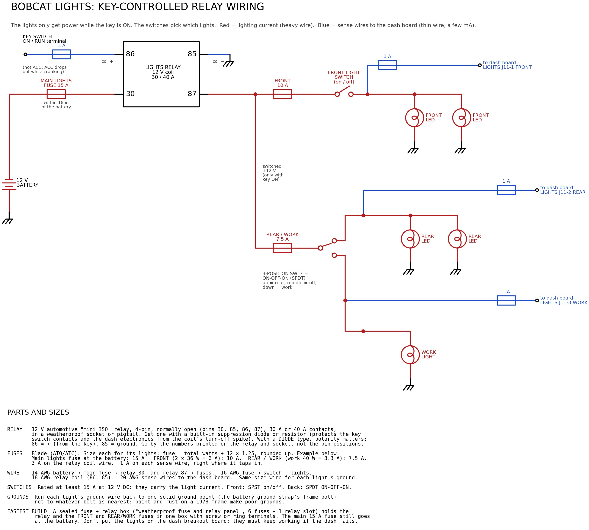

# M.O.S.S.: Maintenance, Operations, and Service System

(The `bobcat-dash` project.) A full-screen gauge display for a 1978 Bobcat M700 skid steer (Wisconsin VH4D 4-cylinder gas engine,
PerTronix electronic ignition), running on a Raspberry Pi.

| Gauge / light | Sensor | Green | Amber | Red |
|---|---|---|---|---|
| Battery, engine off | ADS1115 ch 0 through a voltage divider | 12.2–14.8 V (`CHARGING` at 13.2 V and up, e.g. a battery charger) | 11.8–12.2 V (LOW), 14.8–15.5 V (HIGH) | < 11.8 V or > 15.5 V |
| Battery, engine running | same | 13.2–14.8 V (CHARGING) | 12.0–13.2 V (NOT CHARGING), 14.8–15.5 V (HIGH) | < 12.0 V or > 15.5 V |
| Fuel level | ADS1115 ch 1, fuel sender | > 25 % | ≤ 25 % | ≤ 12 % |
| Tachometer | GPIO 17, from the ignition coil's negative terminal (PerTronix) through the board's coil input | 800–3050 rpm (VH4D governed ≈2950 no-load) | LOW IDLE (600–800 rpm for 1 s while running), 3050–3200 rpm | ≥ 3200 rpm (overspeed) |
| Engine oil pressure | GPIO 22, original switch through an optocoupler | OK | | LOW (flashing) |
| Hydraulic filter bypass | ADS1115 A2, monitored (4.7 kΩ resistor at the switch) | OK | | BYPASS (flashing) |
| Hydraulic oil temp | ADS1115 A3, monitored (4.7 kΩ resistor at the switch) | OK | | HOT (flashing) |

The battery panel switches between its engine-off and engine-running limits automatically, and its
color bar redraws to match. A caption in the panel's corner shows which set is active.

Grey means **no signal**: a broken wire, an unplugged sender, or an ADC that isn't answering. The filter
and temp switches are **monitored**: a resistor at each switch lets the dash spot a broken or unplugged
wire, which otherwise would look like a healthy open switch (see [End-of-line resistors](#end-of-line-resistors-filter-and-temp-switches)). The
header shows a summary: `ALL OK`, `CHECK n`, or a flashing `n ALARMS`. Every threshold is
in `config.toml`.

On startup, all warning tiles flash red for 2 seconds as a **lamp test**, like an old bulb check.
With the engine stopped, the oil-pressure switch is always closed, so that tile shows grey
`ENGINE OFF` instead of red.

The **tach decides** whether the engine is running. If it reads 0 rpm but the battery is at charging
voltage (13.2 V or more), the **oil pressure switch** settles it:

| Tach | Battery | Oil pressure | Means | Dash shows |
|---|---|---|---|---|
| 0 rpm | 13.2 V+ | none | Parked with a **battery charger** connected | `ENGINE OFF`, green `CHARGING`, no warnings |
| 0 rpm | 13.2 V+ | present | Engine running, **tach sensor dead** | `ENGINE RUNNING`, amber `CHECK SENSOR` on the tach |

Once a dead tach has been seen on a running engine, the dash remembers it until the alternator voltage
drops (engine stopped) or the tach reads again. If oil pressure is lost in that time, it's still a red
alarm with the horn. A charger on a parked machine can't set off the horn, and a dead tach can't hide
low oil pressure.

---

## Parts list

The full list with part numbers and quantities is the spreadsheet [`docs/bobcat-dash-BOM.xlsx`](docs/bobcat-dash-BOM.xlsx) (made by `tools/diagrams/make_bom.py`). The main parts:

| Part | Notes |
|---|---|
| Raspberry Pi 4 (2 GB is plenty) or Pi 5 | |
| Weatherproof HDMI monitor with its own 12 V supply, 1024×768 or similar | Any resolution works because the layout scales. Sunlight-readable (≥ 800 nits) helps a lot outdoors. Wiring: see [Monitor and boot splash](#monitor-and-boot-splash). |
| 12 V automotive relay (30/40 A, with socket) + fuse holder | Feeds the LED lights through the key. See [Lights](#lights). |
| 3× inline fuse holder, 1 A | One on each light sense wire, where it taps into the light circuit |
| ADS1115 16-bit ADC breakout | I2C, 4 channels: battery, fuel, filter, temp |
| 2× PC817 optocoupler | Oil pressure and tach. Keeps 12 V off the Pi. |
| 12 V → 5 V automotive buck converter, **5 A** (8–36 V input) | Don't use a cigarette-lighter USB plug. Pi 5 needs 5 A. |
| Inline fuse holder, 3 A | On the 12 V feed from the ignition switch (hand-wired). With the breakout board rev 2.0: 7.5 A at the battery on the constant feed, plus 2 A on the IGN wire. |
| Resistors: 47 kΩ, 4× 10 kΩ, 220 Ω, 2× 2.2 kΩ, 3× 4.7 kΩ, 100 Ω | |
| 2× 4.7 kΩ ½ W metal film resistor | **End-of-line resistors**, fitted at the filter and temp switches |
| 8× BAT85 Schottky diode | Clamp the ADC inputs (one to 3.3 V, one to GND, per input A0–A3) |
| 2× 1N4148 diode, 4× 0.1 µF capacitor | |
| Tach signal: a wire from the ignition coil's **negative** terminal | This machine (PerTronix + Flame-Thrower 40611 coil) uses the breakout board's COIL input (its own `COIL` plug since rev 2.4). A NJK-5002C Hall sensor + magnet on the crank pulley is the alternative, and the only option when hand-wiring. |
| Weatherproof enclosure, Deutsch/Weatherpack connectors | Vibration kills loose Dupont jumpers |

## Wiring

All Pi-side grounds connect together: Pi GND, ADS1115 GND, and the optocoupler output side.
The 12 V side of the optocouplers stays separate from the Pi side.

```
POWER (hand-wired: the Pi loses power the moment the key is turned off)
  Ignition switch (+12V) ──[3A fuse]──> Buck converter IN+ ──> 5V OUT ──> Pi USB-C / 5V pins
  Chassis ground ──────────────────────> Buck converter IN- ──> GND

POWER (breakout board rev 2.0: clean shutdown at key-off, see "Key-off shutdown")
  Battery + ──[7.5A fuse, at the battery]──> board POWER IN "BAT+"   (constant, always live)
  Key switch IGN terminal ──[2A fuse]──────> board POWER IN "IGN"    (a few mA: sense only)
  Chassis ground ──────────────────────────> board POWER IN "GND"
  Board "TO BUCK" ──> Buck converter IN+ / IN-  (switched by the board)

ADS1115                     Pi
  VDD ───────────────────── 3.3V (pin 1)
  GND ───────────────────── GND  (pin 6)
  SDA ───────────────────── GPIO2 / SDA (pin 3)
  SCL ───────────────────── GPIO3 / SCL (pin 5)
  ADDR ──────────────────── GND  (address 0x48)

BATTERY VOLTAGE  -> ADS1115 A0
  +12V (ignition) ──[47k]──┬──────────> A0
                           ├──[10k]───> GND
                           ├──[BAT85, band toward 3.3V]──> 3.3V
                           ├──[BAT85, band toward A0]────> GND
                           └──[0.1µF]──> GND
  The BAT85s only conduct if A0 goes above 3.3 V or below 0 V. Don't use a 3.3 V zener here:
  low-voltage zeners leak tens of µA, which would pull the battery reading low.
  Ratio = (47+10)/10 = 5.7, so 15.5 V reads as 2.72 V on the ADC.

FUEL SENDER  -> ADS1115 A1
  Setup A, sender wired only to the dash:
      3.3V ──[220Ω]──┬──> A1           (+ two BAT85 clamps and 0.1µF, as for A0)
                     └──> sender terminal (the sender grounds through the tank)
  Setup B, an analog gauge as well (a backup if the Pi or monitor fails):
      12V (key) ──> gauge ──> sender terminal ──[47k]──┬──> A1   (no 220Ω pull-up)
                                                        └──[10k]──> GND
  The breakout board does either with jumpers JP1/JP2. Calibrate with --calibrate (below).

OIL PRESSURE SWITCH  -> GPIO 22, through an optocoupler
  The oil switch closes to ground when pressure is low.

  +12V (ignition) ──[2.2k]──> PC817 LED anode (+)
  PC817 LED cathode (-) ────> oil switch terminal
  1N4148 across the LED, reversed (protects it from voltage spikes)

  PC817 collector ──> GPIO 22      (Pi internal pull-up is enabled)
  PC817 emitter ────> Pi GND

  Switch closes -> LED lights -> GPIO pulled low -> alarm.

HYD FILTER BYPASS + HYD OIL TEMP SWITCHES  -> ADS1115 A2 / A3, monitored
  At each switch: a 4.7k "end-of-line" resistor from the switch terminal to ground
  (see "End-of-line resistors" below). At the Pi end, for each switch:

  3.3V ──[4.7k]──┬──[10k]──┬──> A2 (filter) / A3 (temp)
                 │         ├──[BAT85, band toward 3.3V]──> 3.3V
                 │         ├──[BAT85, band toward A2]────> GND
                 │         └──[0.1µF]──> GND
                 └──────────> switch wire (to the switch + its 4.7k resistor)

  Wire reads ~1.65 V = OK, ~0 V = switch closed (alarm), 3.3 V = wire broken (NO SIGNAL).
  Nothing else may connect to these two switches (no lamps): any 12 V on the wire reads as "broken".

  Optional status LEDs driven by the Pi: GPIO 23 (filter) / GPIO 24 (temp) ──[470Ω]──> LED ──> GND.
  On = switch closed, blinking = wire broken, off = OK.

TACH  -> GPIO 17   (hand-wired: Hall sensor only. For the ignition coil, use the breakout board's COIL input.)
  NJK-5002C Hall sensor: brown = +12V, blue = ground, black = signal (NPN, pulls low near a magnet)
  +12V ──[2.2k]──> PC817 LED anode;  LED cathode ──> sensor black wire
  PC817 collector ──> GPIO 17, plus a 4.7k pull-up to 3.3V (faster edges than the internal one)
  PC817 emitter ──> Pi GND
```

> **Tach from the ignition coil (this machine).** The Wisconsin VH4D has a PerTronix electronic
> distributor and a Flame-Thrower 40611 coil (3.0 Ω). The tach reads the coil's **negative (−)
> terminal**, the same place a normal aftermarket tach connects, on the breakout board's **COIL** plug (the
> 2-pin plug on the board's left edge, inside the boxed HIGH VOLTAGE corner; rev 2.4). Each spark is one pulse, and a 4-cylinder four-stroke fires twice per crank turn, so
> `pulses_per_rev = 2.0`.
>
> That terminal jumps to about 300–400 V every time the coil fires, so it must **only** go to the COIL
> plug, never to TACH SIG or any other input. The board's coil input is built for it: two ½ W resistors take the
> voltage, a 15 V zener clamps it, and a 1 µF capacitor smooths the coil's ringing so each spark gives one
> clean pulse into its own optocoupler. The software also ignores anything within 3 ms of a pulse
> (`min_pulse_gap_ms`), as a second line of defence. Run a 20 AWG wire from the coil − terminal to the
> board, away from the spark plug leads. Shielded wire is better still: connect the shield's drain to the
> COIL plug's GND pin and leave it unconnected at the coil end. Per PerTronix, this coil needs **no ballast resistor** or resistance
> wire in its + feed.
>
> No sensor, magnet or bracket is needed on the crank pulley. The trade-off: if the ignition stops, the tach
> reads 0. That's fine, because the engine has stopped too.

## Low idle and cool-down

**LOW IDLE** (amber, one soft beep). If the engine is running but sits below 800 rpm for more than
a second, the RPM pill turns amber and reads `LOW IDLE`. The dial shows the same band in amber, from
600 to 800 rpm. A sagging idle usually means a stall is coming: fuel starving, a plugged
fuel filter, the choke left on, or carb icing. It's ignored for the first 5 s after start-up.
Set `low_idle_below = 0` in `[tach]` to turn it off.

**Cool-down reminder** (information only: no sound, and not a warning). The VH4D is air-cooled, and the
repair manual says to idle it at 1000–1200 rpm for 3–5 minutes after hard running before shutting off.
The dash keeps track:

1. Time at or above 2000 rpm adds up as hard work. Short dips don't reset it.
2. Once there's 5 minutes of it, bring the hand throttle back to idle (1300 rpm or below). The RPM pill
   then counts down: `COOL DOWN 2:40`.
3. Rev above 1300 rpm and the countdown starts over. At part throttle (1300–2000 rpm) the pill says
   `IDLE TO COOL DOWN`.
4. When it's done: `OK TO SHUT DOWN` in green for a minute.

Stopping the engine clears it. The numbers are in `[cooldown]` in `config.toml`.

## Machine angle (roll and pitch)

The **MACHINE ANGLE** panel shows the machine from behind (roll, side to side) and from the side (pitch, nose
up or down). The outlines tilt with the machine, over a dashed level line, with the angle in degrees and which
way it's leaning. Battery and fuel share the panel above it, and the warning tiles are a little shorter to make
room.

| | Amber `STEEP` (one beep) | Red `TIP RISK` (alarm tone + horn) |
|---|---|---|
| Roll (either side) | 8° | 15° |
| Pitch, nose up | 15° | 20° |
| Pitch, nose down (backing up a steep incline) | 20° | 25° |

**These limits are not from Bobcat.** Bobcat's manuals give no angles: they say to keep the heavy end of the
loader uphill and to travel straight up and down slopes, never across. These defaults are chosen for this
machine: roll warns earliest because side slopes are where a skid steer is least stable, and nose down allows
the most because steep inclines are backed up, with the nose pointing downhill and the heavy end uphill. Change them in `[tilt]`, and use
lower limits if you often work with a loaded or raised bucket. An angle must last 0.5 s before it shows (a bump
isn't a slope), and clears 1° back inside the limit.

**Sensor:** an **LSM6DSOX** accelerometer + gyro board (Adafruit 4438, or the LSM6DS3TR-C, Adafruit 4503). It plugs
into the breakout board's latching **TILT** connector (Molex Micro-Fit 3.0, rev 2.6): pin 1 GND, 2 3V3, 3 SDA,
4 SCL. Make the cable from 22–24 AWG wire (4-core shielded is best): a Micro-Fit housing 43645-0400 with four
43030-0007 crimp pins at the board end, and the other end soldered straight into the sensor board's VIN, GND,
SDA and SCL holes (its small STEMMA QT socket is friction-only and would shake loose). It shares the Pi's I2C
bus with the ADS1115.

**Cable length:** I2C is meant for short runs, and a skid steer is electrically noisy. Under ~30 cm is ideal;
up to ~50 cm is fine routed away from the coil and plug leads (shielded 4-core is better, shield grounded at
the board end only). Up to ~1 m, also slow the bus with `dtparam=i2c_arm_baudrate=50000` in
`/boot/firmware/config.txt`. Further than that, use a differential I2C extender (e.g. SparkFun QwiicBus,
PCA9615). The dash blends the gyro and accelerometer, so
braking, bouncing and turning don't make the angle jump.

- **Mount it rigidly** to the frame, or inside a dash box that's bolted solidly to it (not on rubber
  isolators). Flat, with the board's **X arrow pointing forward**. Other orientations: `axes` and `upside_down`
  in `[tilt]`.
- **Zero it once**, parked on level, firm ground with the engine off: `python3 dash.py --zero-tilt`. It saves
  the level point (and the gyro's small offset) in the data folder, where it stays through every key-off. It
  refuses if the sensor reads more than 5° off level (parked on a slope, or the sensor mounted crooked) or if
  the readings move (engine running, someone climbing on). Add `--force` only if you're sure the machine is
  level.
- **Parking and restarting on a slope is fine.** Nothing needs remembering: gravity gives the true angle at
  every start-up. The first second is averaged (during the boot splash) so engine vibration doesn't skew
  it. If you're parked past a limit, the panel says so as soon as the dash is up.
- **If the sensor is missing or fails, the panel shows grey NO SIGNAL, never a guessed "level".** It counts
  as `CHECK` in the header and plays the connection-lost sound once; nothing else on the dash is affected.
  The dash keeps trying: a sensor plugged in later is picked up within about 2 s. A plug that works loose
  and back in, or a power blip, makes the chip restart powered down and read all zeros; that's caught
  (along with any reading where gravity isn't about 1 g, or the chip losing its settings), and the sensor is
  set up again and re-averaged for a second before an angle shows. A single glitchy read is ignored. Each
  problem is written once to the log (`journalctl -u bobcat-dash`).
- To leave tilt out entirely, set
  `enabled = false` in `[tilt]`: the screen goes back to the original layout (separate battery and fuel panels,
  taller warning tiles).

## Temperatures

The header shows temperatures next to **BOBCAT**: the electronics box (E-box) air, then your probes.

```
BOBCAT   E-BOX 100°F   CAB 92°F   OUT 104°F          ENGINE RUNNING              ALL OK
```

- **E-BOX** (electronics box) is the DS18B20 on the breakout board (rev 2.7): the air inside its enclosure. Above **50 °C
  (122 °F)** it turns into an amber **E-BOX HOT** pill (one beep, counts in `CHECK`); above **65 °C (149 °F)** red
  (alarm tone, no horn). The breakout board's own parts are rated well above that; the limits warn you that
  the box is cooking (no ventilation, direct sun) before anything else in it suffers. If the board sensor
  stops answering it shows grey `BOX --` (and the connection-lost sound).
- **Probes:** waterproof DS18B20 probes (stainless tip on a cable, 3-wire) plugged into the board's
  **TEMP PROBE** connector: red to 3V3, black to GND, yellow (or white) to DQ. Several can share the one
  connector (splice them together, or use a small junction). Each shows by the name you give it, e.g. `CAB`
  and `OUT`, or set `ambient = "average"` for a single `AMB` reading. A missing probe shows `--`.
- **Setup:** once, `dtoverlay=w1-gpio` in `/boot/firmware/config.txt` (see *Installing on the Pi*). Then
  `python3 dash.py --temps` lists every sensor with its ID and reading. Hold one in your fingers for 20 s and
  run it again to see which is which, then put the IDs in `[temperature]`: `board_id` and the `probes` list
  with names. With only the board sensor fitted, nothing needs setting.
- `units = "F"` (or `"C"`) sets what's shown; the E-BOX limits in `config.toml` are in °C.
- Simulator: **=** steps the box through normal, warm, hot and sensor missing; CAB and OUT are simulated.

## Cylinder head temperatures (CHT)

A Type K thermocouple under each spark plug, read by an MCP9601 thermocouple amplifier on the **CHT board**
(rev 3.0), which plugs into the breakout board's **CHT (I2C)** connector. Fit one to four: list the ones fitted in
the web page's **Configuration** page (or `[cht] cylinders`: the module in CHT-board socket 1-4 answers at 0x60, 0x65, 0x66, 0x67). Until then CHT is off.

- **Sensor:** The Sensor Connection **CHT-FS-072-06-18-K-MP** (flexible stem, rated to 1000 °C, *ungrounded*
  junction, 18 mm ring for the VH4D's plugs, male mini K plug). 120 in lead and custom lengths are available.
- **Extension:** only **Type K extension wire** and Type K (yellow) mini connectors between the sensor and the
  board: ordinary copper adds an error that changes with the temperature at the joint. US colours: yellow = +,
  **red = -**. Keep the plastic connectors away from the hot head.
- **On the dash:** a **CYL HEAD TEMP** tile beside the warning lights: the hottest cylinder big, every
  cylinder small underneath. On the web Status page: a tile with each cylinder; Reports: each cylinder's
  daily high and low while running (Extremes).
- **Limits** (°F, `[cht]`): **500 °F** amber CHT HIGH, **550 °F** red with the horn. The factory head
  switches on early Bobcat 700 engines stop the engine over **570 °F** (service manual 7A-3); M.O.S.S. warns
  before that and **never stops the engine itself**. **CHT SPREAD** (amber): with the engine running 5 min
  and warm, one cylinder 100 °F cooler than the average of the others (a fouled plug, misfire or plug wire).
  A broken or unplugged thermocouple shows that cylinder as `--` (NO SIGNAL).
- Simulator: **`** steps through normal / cyl 3 warm / cyl 3 hot / cyl 2 misfiring / cyl 4 unplugged.

## Parking brake

A sealed switch on the parking brake handle, closed when the brake is set, to the breakout board's
**PARK BRAKE** plug (on the CHT + Parking Brake board, GPIO 9). Turn it on once it's fitted: the web page's **Configuration** page (or `[park_brake] enabled = true`).

- **(P) BRAKE** (red) in the header while the brake is set.
- **PARKING BRAKE ON** (amber, flashing (P)): the brake is set while the engine works above idle for 5 s.
- **SET PARKING BRAKE** on the key-off countdown (with a beep) if it isn't set. A broken wire reads as
  "released", so this reminder also proves the switch works: set the brake and it goes away.
- Simulator: **/** sets / releases it.

## Pi health warnings

The dash also watches the Pi itself, and shows two amber warnings in the header (one beep each, and they
count in the header's `CHECK` total):

- **`PI HOT 84°C`**: the Pi's CPU is at or above 80 °C, or the Pi is already slowing itself down for heat.
  It protects itself (it slows down rather than failing), but that should never happen in normal use. It
  means the enclosure is cooking: add or fix the Pi's fan and heatsink, shade the box, or move it away from
  the engine side.
- **`LOW 5V`**: the Pi saw its 5 V supply sag. A weak or undersized buck converter, a thin or long 5 V wire, or
  the battery dipping below the buck converter's minimum input while cranking. It stays up for 10 s after each
  dip so a short sag isn't missed. Occasional dips while cranking are a sign to pick a buck converter rated
  down to 6–8 V input.

Settings are in `[pi_health]` in `config.toml`. On a computer that isn't a Pi they stay quiet. Simulator: **I**
(hot Pi) and **U** (low 5 V) turn each warning on and off.

## Charging system (Delco 10SI)

This machine uses a Delco 10SI 3-wire alternator (internal regulator) in place of the old generator and
external regulator. The wiring is in [`docs/wiring-schematic.jpg`](docs/wiring-schematic.jpg), section 7:

- **BAT stud:** 8 AWG to the battery + through a fusible link or breaker (10 AWG for a 45 A unit).
- **Terminal 2 (sense):** 18 AWG to the battery +, the same point as the board's `BAT+`. The regulator then
  holds the voltage the dash measures.
- **Terminal 1 (excite):** from the key's ON/RUN circuit through a **1N4001 diode** (band toward the
  alternator) and a **47 Ω 5 W resistor**. There's no charge lamp: the dash shows **NOT CHARGING** instead.
  - The diode stops the running alternator feeding ~14 V back into the ON circuit. Without it the PerTronix
    stays powered after key-off (the engine keeps running), and the dash never sees the key go off.
  - The resistor limits the current with the key on and the engine stopped to about 0.25 A, what a charge
    lamp passes. Terminal 1 feeds the alternator's field, so with the diode alone that current is 3-4 A:
    more than a 1N4001's rating, and a flat battery if the key is left on.
- **Grounds:** a heavy, clean engine-to-frame strap. The alternator grounds through its case.

**Starting.** While the starter cranks, a healthy battery sags to about 10 V. The dash recognises cranking
(the coil fires, so the tach reads about 150–300 rpm before the engine catches) and shows an amber **CRANKING**
on the battery and RPM panels and in the header: no alarm, no horn. Below 9.6 V while cranking it says
**WEAK CRANK** instead, a sign of a tired battery or a poor starter cable or ground. For the first 10 s after
the engine catches, a low reading shows **STARTING UP** rather than NOT CHARGING, while the battery recovers and
the 10SI comes up to voltage.

If it **doesn't start** and you let go of the key, the panel goes back to `ENGINE OFF`. The battery shows
`RECOVERING` for a second or two while it climbs back from the starter dip, then its normal reading (about
12.4–12.5 V after a failed attempt): no alarm.

**Starter rest.** Crank for more than 10 s without a start and the header and RPM panel say **REST STARTER**,
with a beep at once and every 5 s while you keep cranking. Let go of the key and the header counts down
**STARTER COOLING 0:29** (the RPM panel shows `REST 0:29`); at zero it shows **READY TO START** in green for a
few seconds. Crank again before the countdown ends and REST STARTER comes straight back, and the countdown
starts over when you let go. It's a reminder only: the starter is wired to the key, not the dash. Use the rest
to check fuel and spark.

The limits are `crank_low`, `crank_detect`, `crank_recover` and `start_grace` in `[voltage]`, and
`crank_limit` (10 s) and `crank_rest` (30 s) in `[tach]`.

**Check after installing:** at a fast idle, a meter at the battery reads about 13.9-14.6 V (the 10SI lowers it
as it warms up). Set `divider_ratio` in `[voltage]` so the dash agrees. Then turn the key off: the engine must
stop, and the dash must count down `KEY OFF`.

## Engine hour meter

A Hobbs-style hour meter sits at the bottom of the RPM panel: `HOURS 1234.5`, four digits and
tenths, with the tenths wheel inverted like a mechanical meter. The tenths wheel **turns
continuously**: it takes 6 minutes (0.1 hour) to roll to the next digit, so after a short run it may
still read the same number. A small green dot pulses while it's counting.

- **It counts only while the engine is running**, using the same running logic as the oil warnings
  (tach, or alternator + oil pressure if the tach sensor has failed).
- **It never resets.** There's no reset on the screen or in `config.toml`. After 9999.9 it rolls
  over to 0000.0, like a mechanical meter, but the full total is kept in the file.
- **Saving:** the meter saves whenever the engine stops, and every 15 seconds while it runs. With the
  breakout board rev 2.0, turning the key off stops the engine, the meter saves, and the Pi shuts down
  cleanly, so **nothing is lost at key-off** (see [Key-off shutdown](#key-off-shutdown)). The 15-second save
  only matters if power is cut unexpectedly (a blown fuse, a battery disconnected with the engine running,
  or a hand-wired setup without the power-hold circuit): then at most about 15 seconds is lost. It keeps
  two copies with checksums, so a power cut in the middle of a save can't lose the total.
- **Where it's kept:** `~/bobcat-dash-data/hours_a.json` and `hours_b.json` (set by `data_dir` in
  `[hourmeter]`). Back this folder up now and then.

**Starting value.** To carry over the reading from your old analog meter, set it once, with the dash stopped:

```bash
sudo systemctl stop bobcat-dash
python3 dash.py --set-hours 2104.6        # shows the current and new totals, asks you to type YES
sudo systemctl start bobcat-dash
```

That same command is the **only** way to change the total later. It refuses to run while the dash
is running, so the two can't overwrite each other. (`initial_hours` in `config.toml` is only used if no
saved total exists yet. Editing it later does nothing.)

In the simulator, the hour meter uses its own file (`~/bobcat-dash-data/simulator/`), so testing
never touches the real hours. Press **P** to add 10 hours, or **X** to run the meter 60 times faster
(one simulated hour per real minute, so the tenths wheel moves every 6 seconds). Press X again for normal speed.

## Key-off shutdown

With the [breakout board](breakout-board/README.md) rev 2.0, the Pi doesn't lose power when you turn
the key off. It finishes up and shuts down properly, then the board turns the power off:

1. **Key off.** The ignition stops the engine. The dash shows `KEY OFF - Shutting down in 5`.
   Turn the key back on within 5 seconds to cancel.
2. **Saving.** The hour meter saves, then the dash shows `SHUTTING DOWN` and powers the Pi off
   (about 10–20 seconds). This protects the SD card as well as the hours.
3. **Power off.** At the very last step of shutdown, after every disk is read-only, the board cuts
   the 12 V feed. With everything off, the board draws less than 0.1 mA from the battery.

Safety nets:

- **Key back on during shutdown:** the board cuts the power for a few seconds and the Pi starts
  up again by itself. You don't have to wait.
- **The dash isn't running** (crashed or stopped): a small separate service, `bobcat-dash-keywatch`,
  watches the key too. If the key has been off for **30 seconds** and the Pi is still up, it shuts the Pi
  down cleanly, so the SD card is still safe. (When the dash is working it has shut down long before.)
- **The whole Pi hangs:** a timer on the board cuts the power **3 minutes** after key-off, no matter
  what. A crashed Pi can't flatten the battery.
- **The key is never seen on** (a board without this circuit, or the key turned off while the Pi was
  still booting): the dash does nothing, and on a rev 2.0 board the timer turns the power off.

How it works: `KEY` (GPIO 6, through an optocoupler) tells the Pi the key position. `HOLD`
(GPIO 26) keeps the power on, and is set by the Pi's firmware at boot. `KILL` (GPIO 16) cuts the
power, and is raised by a small script that systemd runs as the last step of shutdown. The setup
steps are in [Installing on the Pi](#installing-on-the-pi), and the settings are under `[power]` in
`config.toml`. Without the rev 2.0 board, set `enabled = false` there.

**Anything that must stop with the key, like the ignition, fuel solenoid or starter, stays wired to the
key switch, not to the board.** The board keeps its own 12 V outputs (buck converter, tach sensor,
horn) on for up to 3 minutes after key-off.

## Lights

The front, rear and work lights are new 12 V LEDs on their own **manual switches**: front on/off,
and a 3-position switch for the back (up = rear lights, middle = off, down = work light). The
switches stay in charge, so the lights work even if the dash doesn't. The breakout board (rev 2.1)
only **watches** them.

**On the dash** there are two ways to show them; pick one with `display` in `[lights]`:

| `display` | What you see |
|---|---|
| `"tiles"` | Three big tiles across the bottom, **FRONT / REAR / WORK**, always on screen: dark with `OFF` when a light is off, lit solid (green, or amber for the work light) with `ON` when it's on. The warning tiles above them go to half height. Made for a small (7") screen. |
| `"icons"` (default) | The original layout: full-height warning tiles, and small light symbols in the top-right corner of the RPM panel, only while a light is on. |

To use the big tiles, set `display = "tiles"` and restart the dash. In the simulator, **J** switches
between the two so you can compare them.

**Wiring: feed the lights through the key, with a relay.** The full diagram, with parts, fuse and
wire sizes, is [`docs/lights-wiring.jpg`](docs/lights-wiring.jpg).



```
Battery + ──[15 A fuse, at the battery]──> relay 30
Key switch ON/RUN ──[3 A fuse]───────────> relay 86     (coil +, about 0.15 A)
Chassis ground ──────────────────────────> relay 85     (coil −)
relay 87 ──┬─[10 A fuse]──> FRONT switch (on/off) ──> front lights ──> ground
           └─[7.5 A fuse]─> 3-position switch: up ──> rear lights ──> ground
                                               down ─> work light ──> ground

Sense wires to the board's LIGHTS connector, from the LAMP side of each switch position:
  front switch output ──[1 A inline fuse]──> J11 FRONT
  3-way switch UP     ──[1 A inline fuse]──> J11 REAR
  3-way switch DOWN   ──[1 A inline fuse]──> J11 WORK
```

**The relay:** a standard 12 V automotive "mini ISO" relay, 4-pin, normally open (pins 30, 85, 86, 87),
30 A or 40 A, in a weatherproof socket or pigtail. Get one with a built-in **suppression diode** (or
resistor). It protects the key switch and the dash electronics from the spike the coil makes when it
switches off. With a diode type, polarity matters: **86 = + from the key, 85 = ground**. Wire it by the
numbers printed on the relay and socket.

**Easiest build:** a sealed "fuse and relay box" (6 fuses + 1 relay slot) holds the relay and the two
light fuses in one weatherproof box with screw or ring terminals, so there's no loose relay or inline fuses
to mount. The 15 A main fuse still goes at the battery. Keep the lights **off** the dash breakout board:
they have to keep working if the dash fails.

**Sizes** are for example lights (2 × 36 W front, 2 × 10 W rear, 1 × 40 W work). For yours, use
fuse = total watts ÷ 12 × 1.25, rounded up. Wire: 14 AWG battery → relay → fuses, 16 AWG to the lights and
their grounds, 18 AWG for the relay coil, 20 AWG for the sense wires. **Switches** carry the light
current, so use ones rated at least 15 A at 12 V DC: SPST on/off for the front, SPDT ON-OFF-ON for the back.
**Grounds:** run each light's ground wire back to one solid ground point (the battery ground strap's frame
bolt), not to whatever bolt is nearest. Paint and rust on an old frame make poor grounds.

- **Why a relay:** the key switch then only carries the relay coil's current, not the lights'.
  An old key switch's contacts aren't made for several amps of lights on top of the ignition.
- **Use ON/RUN, not ACC.** On most key switches ACC goes dead while cranking, so the lights would black
  out every time you start the engine at night.
- **Lights go off with the key**, whatever the switches are set to, so they can't be left on to flatten
  the battery. Turn the key on and they come back the way the switches are set.
- **Sense wires** carry about 4 mA each. The 1 A fuse at the tap protects the thin wire, since the light
  circuit's own fuse is far bigger.

**On the dash:** a symbol appears in the top-right corner of the RPM panel while each light is on.
It's a green **headlamp** for FRONT, a green **tail lamp** for REAR, and an amber **floodlight** for WORK
(amber, so a work light left on gets noticed). All three show during the start-up lamp test, as a bulb check.

**At key-off:** a soft falling chime (the start-up chime in reverse) says the dash is shutting down.
If any light is **still on** after the key is off, the countdown screen shows
**LIGHTS STILL ON: WORK** (for example) and dings every 1.5 seconds. With the relay wiring above that
can only mean a fault, such as a stuck relay or a light wired straight to the battery.

The sensing tells you a light is **switched on and its fuse is good**. It can't tell you an LED
lamp has failed. Settings are under `[lights]` in `config.toml`; turn the warning off with
`left_on_warning = false`.

## Monitor and boot splash

### Monitor power and HDMI

The monitor has its own 12 V supply and connects to the Pi with an HDMI cable (micro-HDMI on a
Pi 4 / Pi 5). Use the Pi's **HDMI 0** port, the one next to the USB-C power socket.

```
Key switch IGN / RUN ──[fuse, size from the monitor's manual]──> monitor +12 V
Battery ground point (same spot as the board's GND) ──────────> monitor GND
```

- **Feed it from the key switch, with its own fuse**, not from the board's `TO BUCK` output (F1 is
  sized for the Pi) and not from a constant battery feed (it would stay on and drain the battery).
  If the monitor draws more than about 5 A, switch it with a relay from the key instead.
- **Ground it at the same point as the breakout board.** Two different chassis grounds can put noise
  on the HDMI cable's shield (flicker or "no signal" while cranking).
- The screen goes dark the moment the key is turned off. The Pi still finishes its clean
  [key-off shutdown](#key-off-shutdown) in the background, so that's normal.
- **Force the HDMI output on.** The monitor powers up separately from the Pi, and it can dip out
  while the engine cranks. If the Pi doesn't see the monitor at the moment it boots, it may never
  send a picture. Add this to the end of the single line in `/boot/firmware/cmdline.txt`. This
  machine's monitor runs at **1024×768**; if you change monitors, use its native resolution here and
  remake the splash at the same size (`tools/fit_splash.py ... --size WIDTHxHEIGHT`):

```bash
sudo sed -i '1 s/$/ video=HDMI-A-1:1024x768@60D/' /boot/firmware/cmdline.txt
cat /boot/firmware/cmdline.txt     # must still be ONE line, ending in ...@60D
```

  `D` means "output on, even if no monitor is detected". The dash then draws at that resolution.

### Boot splash

Your own picture shows while the Pi boots, stays up for 3 seconds when the dash starts, then fades
into the gauges (lamp test, chime). From key-on to dash, the operator sees the picture, not
scrolling Linux text.

The **Project Moon Pi** logo is already set up: `splash/splash.png` is fitted to 1024×768, and
`splash/splash-800x480.png` and `splash/splash-1280x720.png` are ready if you use a Raspberry Pi display
instead (copy the right one over `splash/splash.png`). The original is kept as `splash/logo-original.png`.
To use a different picture, or a different resolution:

1. **Fit the picture to the screen** (done on any computer; the Pi needs `sudo apt install python3-pil`):

```bash
python3 tools/fit_splash.py ~/Pictures/my_logo.jpg --size 1024x768                 # whole picture, border fills the rest
python3 tools/fit_splash.py ~/Pictures/my_logo.jpg --size 1024x768 --mode cover    # fill the screen, trim the edges
```

   The small patch in the dash's header, on the ABOUT screen, on the web pages and in exported reports is `splash/logo.png` / `splash/logo-small.png`, made from `splash/logo-original.png` by `python3 tools/make_logo.py` (it cuts the black away round the patch).

   It writes `splash/splash.png` at exactly the screen's resolution. Use the same resolution as the
   `video=` setting above. `contain` (default) keeps the whole picture and fills the leftover space with
   a colour taken from the picture's edge; `cover` fills the screen and trims whatever doesn't fit.
   That one file is enough for the dash: it shows it at start-up, settings in `[splash]` in `config.toml`.
   Under the picture the dash writes **Maintenance, Operations, and Service System** (M.O.S.S.) and the software version and build date
   (`caption` in `[splash]`; the picture is fitted above that text).

2. **Make the boot version of the screen** (picture + text, exactly as the dash shows it):

```bash
python3 ~/bobcat-dash/dash.py --boot-splash      # writes splash/boot-splash.png
```

   It's made at the `[display]` width × height (1024×768 when those are 0). Because the Pi's boot and
   the dash show the same picture, nothing jumps when the dash takes over.

3. **Show it during the Pi's boot too** (Plymouth). Once, on the Pi:

```bash
sudo apt install -y rpd-plym-splash                       # the Raspberry Pi boot-splash theme
sudo cp /usr/share/plymouth/themes/pix/splash.png ~/splash-original.png   # keep the original
sudo cp ~/bobcat-dash/splash/boot-splash.png /usr/share/plymouth/themes/pix/splash.png
sudo raspi-config nonint do_boot_splash 0                  # turn the splash on ("quiet splash")
echo "disable_splash=1" | sudo tee -a /boot/firmware/config.txt      # hide the rainbow square
sudo sed -i '1 s/$/ logo.nologo vt.global_cursor_default=0/' /boot/firmware/cmdline.txt   # no logos, no cursor
sudo plymouth-set-default-theme --rebuild-initrd pix
sudo reboot
```

   Plymouth shows the picture pixel-for-pixel without scaling, which is why it's made at the
   screen's exact size. To change the picture later, repeat steps 1 and 2, then the third and last two
   commands of step 3. Do steps 2 and 3 again after a software update too, so the boot screen shows the
   new version number.

### Software version

The version and build date are in `version.py`. They show under the splash picture, in the bottom-left
corner of the RPM panel (`v1.0.0`), in the log at start-up, and with `python3 dash.py --version`.
To release a new version: `python3 tools/bump_version.py 1.1.0` (sets the build date to today), then
remake the boot splash (steps 2 and 3 above).

## Sound and alarm horn

| Event | Speaker | External horn |
|---|---|---|
| Start-up (during the lamp test) | — | 0.3 s chirp, to prove the horn works |
| System ready (lamp test done) | `startup.wav`: warm chord swell + rising bells | — |
| Red alarm: oil pressure, hyd filter, hyd temp, overspeed, battery | `alarm.wav`: urgent triple chime, repeating | pulses 0.5 s on / 0.5 s off |
| Red low fuel | `alarm.wav` | — (set in `horn.sources`) |
| New amber warning lasting 3 s or more (including LOW IDLE) | `warning.wav`: soft two-note ding | — |
| Key turned off (dash about to shut down) | `keyoff.wav`: the start-up bells, falling | — |
| A light still on after key-off | `warning.wav`, every 1.5 s during the countdown | — |
| A sensor stops answering (grey `NO SIGNAL`) for 2 s or more | `nosignal.wav`: burst of radio static, then three falling notes | — |

The **NO SIGNAL** sound means a wiring problem, not a machine problem: a broken or unplugged
sensor wire, a dead sender, or the ADC not answering. It plays once per dropout. If several
sensors drop out together (e.g. the ADC module is unplugged) you hear it once. It plays again
only after that sensor has reconnected and dropped out again, so a loose connector that flickers
for less than 2 s stays quiet. During a red alarm it waits until the alarm stops. Turn it off
with `nosignal_sound = false`, or change the wait with `nosignal_delay`, in `[audio]`.

**Your own sounds:** the sounds are ordinary WAV files in `sounds/`. To use different ones, copy
your WAV files into `sounds/` and point `startup_file`, `alarm_file`, `warning_file` and `nosignal_file` in
`config.toml` at them. Any sample rate, mono or stereo, works; 16-bit PCM is the safest format.
The alarm loops, so end it with a little silence to leave a gap between repeats. If a file is
missing, the dash plays a plain built-in tone instead, so it never goes silent.
To recreate or tweak the supplied sounds: `pip install numpy`, then `python3 tools/make_sounds.py`.
Preview them on a Mac with `afplay sounds/startup.wav`, or on the Pi with `aplay sounds/startup.wav`.

**Silencing:** press the silence button, tap the screen, or press **M**. That silences the
alarms that are on now, and the header shows `n ALARMS - SILENCED`. A **new** alarm sounds again
right away. A silenced alarm that clears and comes back sounds again too.

**Start-up grace:** oil pressure takes a few seconds to build after the engine catches, so the oil
light can't alarm for `start_delay` seconds (5 s) after start-up. While it waits, the tile turns
**amber** and shows `BUILDING`. It goes green as soon as the pressure switch opens. If pressure still isn't
up after 5 s, it goes red and the horn sounds.

### Speaker or external horn?

**Use both.** A small speaker is fine for the chime, but it isn't loud enough to be your alarm:

- An old skid steer puts roughly **90–100+ dBA** at the operator's ear, and you may be wearing
  hearing protection. A 3 W speaker on a Pi amp manages about 85–88 dB at 1 m, so it gets
  buried under the engine and doesn't hold up to vibration, dust or rain.
- A **12 V panel-mount piezo alarm rated 100–110 dB** costs a few dollars, draws under 0.2 A,
  is sealed (look for IP65 or better), and cuts through engine noise. Mount it in the operator
  area, aimed at the operator.
- **Don't use the machine's own horn.** People on the ground hear a horn as "look out", and
  a backup-alarm sound means "reversing". A distinct pulsing piezo means "check the dash".

So the speaker plays the chime and acts as an in-cab backup, and the piezo is the alarm.

### Wiring

```
HORN DRIVER  (GPIO 27 -> logic-level N-MOSFET, low-side switch)
  +12V (ignition) ──[1A fuse]──> piezo alarm (+)
  piezo alarm (-) ─────────────> MOSFET drain        (AO3400, IRLZ44N or a "MOSFET trigger module")
  MOSFET source ───────────────> ground
  GPIO 27 ──[100Ω]──> MOSFET gate,  gate ──[10k]──> ground   (keeps the horn off while the Pi boots)
  1N4007 across the alarm (band to +12V): needed if you use a coil horn or a relay

  Or use a 1-channel opto-isolated relay module (input on GPIO 27). That's simpler,
  but you hear it click. If the module turns on when its input is LOW, set active_high = false.

SILENCE BUTTON  (GPIO 5)
  GPIO 5 ──> momentary push button ──> Pi GND        (internal pull-up is used)
  Mount it where you can hit it with a glove on.

SPEAKER  (MAX98357A I2S amplifier, works on Pi 4 and Pi 5)
  Vin -> 5V    GND -> GND    BCLK -> GPIO 18 (pin 12)    LRC -> GPIO 19 (pin 35)    DIN -> GPIO 21 (pin 40)
  Speaker: 4 Ω, 3 W, weather-resistant (marine or "waterproof" type)
  Add to /boot/firmware/config.txt:   dtoverlay=max98357a
  Alternative: a USB sound card + small powered speaker, or a Pi 4's 3.5 mm jack + PAM8403 amp.
```

Extra parts: 12 V piezo alarm (100–110 dB), logic-level MOSFET (or relay module), 100 Ω + 10 kΩ
resistors, 1 A fuse, momentary push button, MAX98357A board, 4 Ω 3 W speaker.

## Breakout board (optional)

Instead of wiring the interface circuits on perfboard, you can have a PCB made: see
[`breakout-board/README.md`](breakout-board/README.md). It has every circuit above, plus fuses,
status LEDs and test points, and it plugs into the Pi with a 40-pin ribbon cable. Rev 2.0 also has
the power-hold circuit for [key-off shutdown](#key-off-shutdown). The GPIO pins for the sensors are
the same as above.

## Installing on the Pi

### Quick setup (one command)

1. On your computer, flash **Raspberry Pi OS Lite (64-bit)** with **Raspberry Pi Imager**. Before writing,
   open its settings (OS customisation) and set: hostname `bobcat-dash`, a username and password, your
   **Wi-Fi**, and **enable SSH**. The Pi needs internet for the setup.
2. Put the card in the Pi, power it up, wait a minute, then from your computer: `ssh YOURNAME@bobcat-dash.local`
   (or plug in a keyboard and log in). Then:

```bash
sudo apt install -y git
git clone https://github.com/ricsne2010/bobcat-dash.git
sudo bash bobcat-dash/tools/setup-pi.sh            # add --fast-boot to also skip Bluetooth / waiting for Wi-Fi
sudo reboot
```

   It does every step below for you: packages, I2C, 1-Wire temperatures, the speaker, the HDMI setting
   (`--resolution 800x480` for another screen), the boot splash, the dash service, and the key-off shutdown
   pieces (`--no-power-hold` for a hand-wired setup without the breakout board). It's safe to run again,
   e.g. after `git pull` for a software update.
3. After the reboot the splash shows and the dash starts by itself. Then [calibrate](#calibrating), name the
   temperature sensors (`python3 dash.py --temps`), and [save a copy of the card](#backing-up-the-sd-card).

### Step by step (what the script does)

1. Flash **Raspberry Pi OS Lite (64-bit, Bookworm or newer)** with Raspberry Pi Imager. Set a
   username (the service file assumes `pi`), Wi-Fi, and SSH. Lite has no desktop, which makes it boot fast.
2. Copy this folder to `/home/pi/bobcat-dash`, then:

```bash
sudo apt update
sudo apt install -y python3-pygame python3-gpiozero python3-lgpio python3-smbus2 i2c-tools
sudo raspi-config nonint do_i2c 0          # enable I2C
i2cdetect -y 1                             # should show 48 (the ADS1115)

cd ~/bobcat-dash
python3 dash.py --calibrate                # raw readings, see below

sudo cp bobcat-dash.service /etc/systemd/system/
sudo systemctl enable --now bobcat-dash    # start now and on every boot
journalctl -u bobcat-dash -f               # view logs
```

**Faster boot (Pi 5).** Key-on to live gauges takes roughly 15–25 s out of the box; these bring it to about
10–12 s. The boot splash covers the wait either way.

```bash
sudo rpi-eeprom-config --edit           # add the line:  PSU_MAX_CURRENT=5000
                                        # (tells a Pi 5 the buck converter can supply 5 A: no power warning
                                        #  at boot, full USB current)
sudo systemctl disable --now bluetooth hciuart        # if you don't use Bluetooth
sudo systemctl disable NetworkManager-wait-online     # don't wait for Wi-Fi before starting
systemd-analyze blame | head                          # what's still slow
```

   A fast A2 microSD card, or an NVMe drive on the Pi 5, also helps. Keep Raspberry Pi OS **Lite** (no desktop).

3. **Key-off shutdown** (breakout board rev 2.0 only, see [Key-off shutdown](#key-off-shutdown)):

```bash
# HOLD: keep the board's power on from the moment the Pi starts
echo "gpio=26=op,dh" | sudo tee -a /boot/firmware/config.txt
# TEMPERATURES: 1-Wire on GPIO 4 for the DS18B20s (breakout board rev 2.7)
echo "dtoverlay=w1-gpio" | sudo tee -a /boot/firmware/config.txt
# KILL: cut the power as the very last step of shutdown
sudo install -m 755 tools/bobcat-dash-poweroff /usr/lib/systemd/system-shutdown/
# let the dash run "systemctl poweroff" without a password
sudo install -m 440 tools/bobcat-dash-sudoers /etc/sudoers.d/bobcat-dash
sudo visudo -c                             # must say "parsed OK"
# BACKSTOP: a clean power-off 30 s after key-off even if the dash isn't running
sudo install -m 755 tools/bobcat-dash-keywatch /usr/local/bin/
sudo install -m 644 tools/bobcat-dash-keywatch.service /etc/systemd/system/
sudo systemctl enable bobcat-dash-keywatch
sudo reboot
```

   Then test it: with the dash running, turn the key off. The screen counts down, shows
   `SHUTTING DOWN`, and about 20 seconds later the board's green `12V ON` and `HOLD` LEDs go out.
   If the screen says *Power-off command failed*, check the sudoers step (the username in it must
   match yours). The board's timer still turns the power off after 3 minutes.

4. **SD card and power cuts.** Without the rev 2.0 board, the key switch cuts power without warning.
   - **Don't enable the read-only *Overlay File System*.** It throws away every write at reboot, which
     would erase the engine hours. If it's on, the dash shows an amber **HOURS NOT SAVED**.
   - Use a **high-endurance** SD card. The card's ext4 file system is journaled, and the hour meter
     writes its file in a way that survives a power cut mid-write (see [Engine hour meter](#engine-hour-meter)).
   - Once it's all working, keep a backup image of the card (Raspberry Pi Imager can make one), and
     copy `~/bobcat-dash-data` somewhere safe now and then: it holds the engine hours.
5. **Monitor and boot splash:** force the HDMI output on, and install your boot picture. See
   [Monitor and boot splash](#monitor-and-boot-splash).

### Backing up the SD card

Once everything works (calibrated, sensors named), save the whole card as an image on your computer. If the
card ever dies, write the image to a new card with Raspberry Pi Imager (*Use custom*) and you're back as you
were, hours and all as of the backup. On a Mac:

```bash
diskutil list                                   # find the card, e.g. /dev/disk4 (check the size!)
diskutil unmountDisk /dev/disk4
sudo dd if=/dev/rdisk4 of=~/bobcat-dash-backup.img bs=4m status=progress
gzip ~/bobcat-dash-backup.img                   # optional: much smaller
```

The image holds your Wi-Fi password: keep it private. The engine hours live in `~/bobcat-dash-data`; copy that
folder off now and then too.

## Screens, history and service reminders

Four menu buttons (◀ ▶ OK BACK, breakout board rev 2.9 `BUTTONS` plug; in the simulator `;` `'` Enter
Backspace, and a USB keyboard works the same) move between four screens. The gauges are home.

| Screen | Shows |
|---|---|
| **GAUGES** | The dash, as always. |
| **HISTORY** | Every alarm, warning and NO SIGNAL that lasted 2 s or more: date and time, engine hours, what, how long. OK on a line for the details and **CLOSE · CLEAR THIS · CLEAR ALL** (CLOSE is selected; both clears ask for the maintenance code, then **ARE YOU SURE?** with **NO** selected: pick YES with the arrows to go ahead). Clearing only takes alarms off this list: the first line, **ALL ALARMS (archive)**, always shows everything ever recorded, cleared ones marked. Kept through power-off (last 500). |
| **SERVICE** | The maintenance schedule from the Bobcat 700 manual, by engine hours (hydraulic items also yearly): what's next and when. The first line is the **CLIMATE** setting. |
| **SYSTEM** | Engine hours, battery, fuel, every sensor's status, box and outside temperatures, the Pi's temperature and warnings, clock, network, SD card space, saving status, software version. **OK** opens **SERVICE WI-FI · UNITS °F/°C · CLOCK · MX CODE · ABOUT**. **ABOUT** shows the Project Moon Pi patch, the software version and date, the breakout board revision, the computer, engine hours, the service Wi-Fi name and where the source lives. |

- **Clock:** the day, date, year and time sit in the menu bar ("Fri Oct 23 2026 · 3:42 PM"; smaller, then just the time, when the bar is busy; amber **CLOCK NOT SET** if it isn't). **12- or 24-hour:** SYSTEM > OK > CLOCK > 12-HOUR/24-HOUR, or the web page's Settings (`[display] clock` is the starting default; `"off"` hides it).
- **◀ ▶** change screen; on HISTORY and SERVICE, **OK** steps into the list, then ◀ ▶ move and OK opens a line.
  **BACK** steps back out; **hold BACK 2 s** to jump to the gauges from anywhere.
- **Safety:** a new red alarm always brings the gauges back and **locks the menu buttons** until the alarm is
  acknowledged with **SILENCE** (the menu bar says so in red), so nobody changes screens by accident with the
  machine in trouble. After 2 minutes without a press the dash goes back to the gauges anyway. Service pop-ups never open with the engine running; while it runs, a due item
  only shows a small `SERVICE DUE` in the header.
- **Service pop-up at key-on** (engine not running): each item that's due, or coming up (within 5 engine hours;
  within 2 h for the 10-hour daily checks), with **DETAILS** (the job, step by step), **MARK DONE** (maintenance code, then **ARE YOU SURE?** with NO selected; records the hours and date),
  **LATER** (ask again at the next key-on), **+5 HOURS**, and **COMPLETED** (when it was done before).
- **Climate:** the manual changes the engine oil interval in heat (every **25 h above 90 °F** instead of 50 h)
  and the oil grade with temperature (SAE 30 down to 5W-20). Pick the climate on the SERVICE screen (OK on
  the CLIMATE line, ◀ ▶, OK). Anyone can look at it, even with the engine running; saving a change asks for the
  maintenance code. Only those items change. The schedule itself is `[service]` in `config.toml`.
- **Dates** need the Pi's clock. There's no daylight-saving switch: the clock follows its **time zone**'s rules by itself (SYSTEM > OK > CLOCK > TIME ZONE, or the web page). Set the time with the **engine stopped**, on the dash (SYSTEM > OK > CLOCK > SET TIME: year, month, day, hour, minute, with the maintenance code) or from the web page (Settings > **Sync to this device**, or **Set by hand**), and on a Pi 5 fit the **RTC battery** (Raspberry Pi part, ML-2020, plugs in
  next to the USB-C socket; the setup script turns on its charging). Without it, and without Wi-Fi, the clock
  can be wrong after power-off: everything also records **engine hours**, which are always right.
- Saved in the hour meter's data folder (`~/bobcat-dash-data`): `events.json` and `service.json`.
- **Pod fan:** the Pi switches the button pod's exhaust fan (breakout board rev 2.9, GPIO 11): on when its CPU reaches
  **55 °C**, off again below **48 °C**, and on during key-off shutdown. Shown on the SYSTEM screen; `[fan]` in `config.toml`.

## Service Wi-Fi, web page and USB stick

**Service Wi-Fi** (no extra button: SYSTEM screen > **OK** > **OK**, engine off, then the **maintenance code**).
The Pi turns on its own Wi-Fi network and a small web site. The pop-up shows the network name (**MOSS-BOBCAT-M700**),
its password, a QR code to scan with a phone camera, and the address to open (**http://10.42.0.1**). The menu
bar shows `WI-FI 27m` while it's on. It stays on for **30 minutes**. **Extend 30 min** on the web page's Status
adds more, as often as you like. It turns off when the time runs out, at key-off, from the web page, or with OK
on the same pop-up. Afterwards the Pi goes back to your normal Wi-Fi by itself. The Wi-Fi password is made up the
first time and then kept, so a phone that joined once joins again by itself. Settings: `[service_mode]` in `config.toml`.

**Maintenance code.** These ask for a 4-digit code, entered with the buttons (◀ ▶ change the digit, OK = next
digit, BACK = previous):
- turning the service Wi-Fi on
- installing software from a USB stick
- clearing alarms (CLEAR THIS / CLEAR ALL)
- marking service done

Once entered it stays good, and the screen shows it (a green **MX UNLOCKED** in the menu bar and a green frame round
the whole screen), until the engine starts or the key goes off.

There's no code out of the box: the first time, the dash asks you to make one up and enter it twice. It can't be
all one digit (1111) or a run up or down (1234, 4321, 7890). Only a scrambled (salted hash) copy is kept, never the
code itself. Three wrong codes in a row lock it for 5 minutes, then 10, 20 and so on, up to 2 hours, even across a
restart. Every wrong code goes into the alarm history as **MAINTENANCE CODE**.

**Changing the code** (say you gave it to someone): SYSTEM > OK > **MX CODE**, with the engine off. Enter the old
code (always asked, even if already entered), OK on the CHANGING THE CODE screen, enter the new code twice, then
check it on the screen: **NO** (selected) enters it again, **YES, SAVE IT** saves it. The new code can't be the old
one, and the same rules apply. The recovery code stays the same, so the paperwork still works. The change goes in
the alarm history.

**Forgot the code?**
1. When you make the code, the dash shows an 8-digit **recovery code** once: write it down and keep it with the
   machine's papers. On the code screen, arrow the first digit to **?** and press OK, enter the recovery code,
   then make a new code (you get a new recovery code too).
2. Lost that too? Take the SD card out of the Pi, put it in any computer, and on its boot drive (the small one
   Windows or macOS can open) make an empty file called `reset-code`. Put the card back: at start-up the dash
   forgets the code, deletes the file, and notes it in the alarm history. (With a keyboard or ssh on the Pi:
   `python3 dash.py --reset-code`.)

| Page | Shows |
|---|---|
| **Status** | Live gauges, warnings on now, service due, Pi temperature and fan. Updates every 2 s. |
| **Reports** | The Alarms card opens the alarm list. For 7 days, 30 days, 12 months or all time: engine time split into **full throttle** (normal working), **idle** (warm-up, cool-down), **part throttle** (for warming a cold engine, pump priming or setting timing: flagged amber above 10 %) and **overspeed**, time at each engine speed, engine time by day, key-on time vs engine time, starts and cranks that didn't start, **hot shutdowns** (shut off before the cool-down finished), alarms by type, temperature and battery charts by day, **extremes** (lowest and highest of each sensor: E-box, each probe such as cabin and outside, Pi CPU, battery while running, with the date and time), and a day-by-day table (10 days a page by default, or 20 / 50 / 100; Newer / Older). |
| **Alarms** | The history list and the archive. |
| **Service** | Each item: interval, last done, hours left, the job; everything marked done. |
| **Configuration** | **Installed equipment:** a switch for each optional part, so nothing that isn't fitted is read, shown or alarmed on: cylinder head temperatures (and each cylinder 1-4), the hydraulic filter and oil temperature switches, the parking brake switch, the machine angle sensor, light sensing (and each light), the alarm horn, the temperature sensors and the pod fan. Saving needs the engine stopped and the maintenance code, is logged in the alarm history, and restarts the dash (about 15 s). The choices are kept in `settings.json` over `config.toml`. |
| **Settings** | **Look of these pages:** Same as this device / Light / **Dark (ECAM)**, an Airbus ECAM-style dark page (cyan labels, green normal values, amber caution, red warning); remembered by each phone or laptop, also the LIGHT / DARK button at the top of every page. **Temperature units** (°F / °C, also on the dash: SYSTEM > OK > UNITS). **Clock:** the dash's time beside this phone's or laptop's, the difference, **Sync to this device** (copies the time and time zone, however far off the dash is) and **Set by hand** (a date and time picker); both need the maintenance code and save the time in the Pi 5's RTC. **Time zone** (Arizona, Pacific, Mountain, Central, Eastern, Alaska, Hawaii, UTC, or this device's): **daylight saving comes with it**, so the clock moves in March and November by itself in zones that use it, and never in Arizona. Sync sets the zone from the phone too. |
| **Downloads** | Everything as one zip, or each file: `report.html`, CSV files (open in Excel), settings, the dash's data (a backup) and log. |
| **Software** | **About**: the patch, M.O.S.S., the machine, software version, board revision, computer, source. Upload an update zip (GitHub: **Code > Download ZIP**). The dash checks it, then **Install** (engine off, and the **maintenance code**: Install, going back and Restart dash all ask for it each time; wrong codes count toward the same lock and are logged with the device). Your `config.toml` and splash pictures are kept, the running version is kept as the **previous version** (one button to go back), and the dash restarts. The new default settings are saved beside yours as `config.toml.new`. |

The usage numbers start when this software is installed (`usage.json` in the data folder). The bands are set
in `[usage]`: idle below 1400 rpm, full throttle from 2600 rpm, overspeed above the tach's amber limit.

**USB stick** (FAT32 or exFAT, in the pod's USB socket, engine off). The dash notices the stick by itself, so
there's no script to run. It copies the same files as the web page's zip to `MOSS-BOBCAT-M700/<date>_<hours>h/` on
the stick. If the stick's top folder holds a zip whose name starts with `bobcat-dash` (GitHub's download is
`bobcat-dash-main.zip`), the dash checks it and asks **INSTALL version x.y.z?** (OK = install after the maintenance code, BACK = no).
Then it unmounts the stick and says when it's safe to pull out. It copies once per plug-in.

Updating from a zip leaves the folder no longer a git checkout (`git clone` afresh if you want git back).
If an update changes anything in `tools/`, run `sudo bash tools/setup-pi.sh` again. The setup script
installs the two small helpers the dash uses for this (`bobcat-dash-wifi`, `bobcat-dash-usb`) and allows only
those in sudoers. The hotspot needs the Wi-Fi country set (Raspberry Pi Imager does it, or `sudo raspi-config`).
In the simulator the web page is at http://localhost:8080. The USB stick is a folder: create
`~/bobcat-dash-data/simulator/usb-stick` to plug it in, and delete it to pull it out.

## Calibrating

Run `python3 dash.py --calibrate` (stop the service first with `sudo systemctl stop bobcat-dash`).
It prints the raw ADC volts, the computed battery voltage, the RPM, and each switch state twice a second.

- **Battery:** compare with a multimeter at the battery and set
  `divider_ratio = meter_volts / A0_volts`.
- **Fuel:** note the `A1` reading with the tank empty, about half, and full, and put them in
  `table = [[volts, 0], [volts, 50], [volts, 100]]`. Add more points if your sender is nonlinear.
- **Tach:** check against a handheld optical tach (a strip of reflective tape on the crank pulley) at idle and
  at full throttle. With the coil input, `pulses_per_rev = 2.0` should already be right for the 4-cylinder. If the
  dash reads exactly double or half, the setting is wrong. If it jumps around, check the coil wire's ground and routing.
  Then check the engine's speeds: low idle (about 1000) and **full throttle with no load** (about 2950 on
  the VH4D: the governor holds 2800 under full load). Put the no-load figure in `governed_rpm`, and keep
  `amber_above` about 100 rpm above it so normal full throttle stays green.
- **Oil switch:** unplug its wire and touch it to ground. It should show `ON`.
  If it reads backwards (a modern normally-closed sensor), set `active_low = false` or swap the wiring.
- **Filter and temp switches:** each shows its voltage and state, e.g. `hyd_filter=1.64V ok`.
  Expect ~1.65 V (ok), ~0 V when you ground the wire (`ON`), and 3.3 V with the wire unplugged
  (`WIRE OPEN`). If the OK reading isn't between about 1.4 and 1.9 V, check the end-of-line resistor value.

## End-of-line resistors (filter and temp switches)

The hydraulic filter bypass and temp switches are **normally open**: they only close when there's a
problem. A plain switch input can't tell "switch open, all fine" from "wire cut", so a broken wire
would show a green OK forever. One resistor at each switch fixes that.

**What to buy:** two **4.7 kΩ, ½ W, 1 % metal film** resistors (rated to 155 °C; the hydraulic tank
gets hot), plus adhesive-lined heat-shrink and a ring terminal for each.

**How to wire it, at each switch:**

```
          harness wire from the dash
                    │
   switch terminal ─┼──────────────┐
                    │              │
                 [switch]      [4.7 kΩ]      <- both at the switch
                    │              │
   switch body / ───┴──────────────┴── ring terminal on a clean ground bolt
   hydraulic tank (chassis ground)        next to the switch
```

1. Crimp one resistor lead into the **same terminal as the harness wire** at the switch
   (spade or ring), so the resistor sits right at the switch. Nothing else connects to this
   terminal: any 12 V on the wire (a lamp, for example) would read as a broken wire.
2. Crimp the other lead to a **ring terminal** and bolt it to a clean, bare-metal ground point on
   the tank or frame, as close to the switch as you can. (If your switch has two terminals instead
   of grounding through its body, put the resistor straight across the two terminals.)
3. Slide adhesive-lined heat-shrink over the resistor and both crimps and shrink it, so it's sealed
   against oil and water. Tie it to the harness so it can't vibrate.

**Check it with a multimeter** (power off, harness wire unplugged at the dash end, meter between
that wire and chassis ground):

| Reading | Means |
|---|---|
| **~4.7 kΩ** | Correct: switch open, resistor in place |
| **~0 Ω** | Switch closed (filter in bypass, or oil hot), or the wire is shorted to ground |
| **Open / OL** | Resistor missing, or a broken wire or terminal |

**What the dash shows:**

| Wire voltage at the board | Dash |
|---|---|
| ~1.65 V | green **OK** |
| below 0.8 V | red **BYPASS** / **HOT** + horn |
| above 2.6 V (wire cut, unplugged, or resistor missing) | grey **NO SIGNAL** after 1 second, and the board's status LED blinks |

The thresholds are in `config.toml` (`active_below`, `open_above`). The resistor must be at the
**switch end**. If you put it at the dash end, a broken wire would look like OK again.

## Testing without hardware

On any computer with Python 3.11+ and pygame:

```bash
pip install pygame
python3 dash.py --sim --windowed
```

| Key | Action |
|---|---|
| S | start / stop engine. Starting cranks for about 2.5 s (~200 rpm, battery dips to ~10 V), then it catches and the alternator brings the battery up to ~14.1 V over a few seconds. Times are in `[sim]`. |
| C | cold engine: a longer crank (~5.5 s) and a deeper dip |
| W | engine won't start: it cranks until you press S again (letting go of the key) |
| K | key on / off. **The simulator starts with the key off** (powered down): press K to "boot" it. It shows the boot splash picture for about 6 s (a stand-in for the Pi booting, then the dash's own 3 s), then the lamp test and gauges. Key off stops the engine, counts down 5 s and "powers off" |
| ↑ / ↓ | throttle: idle 1000 rpm up to the governed 2950 rpm at full throttle |
| 1 / 2 / 3 | toggle oil / filter / temp warning |
| 4 / 5 / 6 | unplug / replug the oil / filter / temp sensor (grey NO SIGNAL; the "connection lost" sound plays after 2 s) |
| B | cycle battery presets: auto → 12.5 V resting → 12.0 V low → 11.2 V very low → 0 V dead → 15.0 V high → 16.2 V overcharge |
| [ / ] | battery voltage down / up 0.2 V, for finding the exact amber/red points |
| V | unplug / replug voltage sensor (NO SIGNAL) |
| F / G | fuel down / up 5 % |
| L / E / R | fuel low (10 %) / empty (0 %) / refill (100 %) |
| N | unplug / replug fuel sender (NO SIGNAL) |
| O | oil pump fails / works: pressure never builds, so it alarms 5 s after start-up |
| T | tach sensor fails / works: reads 0 rpm while the engine keeps running |
| Z | governor fails / works: the engine runs away past the red line (overspeed alarm + horn) |
| D | engine bogs to ~700 rpm / recovers: LOW IDLE warning |
| P | hour meter +10 h (simulator's own hour file only) |
| X | hour meter and cool-down timer run 60× faster / normal speed (5 min of hard work takes 5 s) |
| I / U | Pi too hot (PI HOT) / 5 V supply low (LOW 5V): each press turns it on or off |
| Left / Right | roll the machine 3° (Right = right side down) |
| , / . / 0 | pitch 3° nose down / nose up; 0 = back to level |
| - | unplug / replug the tilt sensor: NO SIGNAL, then a second's re-averaging when it's back |
| = | electronics box (E-BOX) temperature: normal / warm (E-BOX HOT, amber) / hot (red) / sensor missing |
| ` | cylinder head temperatures: normal / cyl 3 warm (amber) / cyl 3 hot (red, horn) / cyl 2 misfiring (CHT SPREAD) / cyl 4 unplugged |
| / | parking brake set / released |
| J | light display: big tiles / small icons |
| 7 | front light switch on / off |
| 8 / 9 | the 3-position back switch: rear lights / work light (pressing the other one switches over, pressing the same one again = middle, off) |
| Y | lights wired to the battery instead of the key, to try the **LIGHTS STILL ON** warning at key-off |
| A | reset all overrides |
| H | show / hide the key list on screen |
| Esc / Q | quit |

An amber `SIM` tag in the header shows which test override is active.
Tip: try **12.0 V with the engine running** to see the amber `NOT CHARGING` warning.

## Adding another warning light

Copy a `[warnings.*]` block in `config.toml`, give it a new name, GPIO, and label, and wire
another optocoupler. The bottom row resizes to fit. All four ADS1115 inputs are now in use, so a new
*monitored* switch would need a second ADS1115 (ADDR pin to VDD gives address 0x49).

## Files

- `dash.py`: display and alarm logic
- `sensors.py`: ADS1115 driver, tach pulse counter, switch debouncing, simulator
- `hourmeter.py`: engine hour meter: counting, power-cut-safe saving, `--set-hours`
- `version.py`: software version and build date; `tools/bump_version.py` changes them
- `power.py`: key-off shutdown (breakout board rev 2.0)
- `cooldown.py`: cool-down reminder after hard work
- `pihealth.py`: Pi temperature and 5 V supply warnings
- `starter.py`: starter rest reminder and cooling countdown
- `tilt.py`: machine angle: sensor reader, gyro/accelerometer blending, limits, `--zero-tilt`
- `temps.py`: box and probe temperatures (DS18B20, 1-Wire), E-BOX HOT limits, `--temps`
- `cht.py`: cylinder head temperatures (MCP9601 thermocouple amplifiers, I2C), limits and the spread check
- `brake.py`: parking brake tell-tale and reminders
- `tools/bobcat-dash-poweroff`: last-step shutdown hook that tells the board to cut the power
- `tools/bobcat-dash-keywatch` (+ `.service`): backstop that powers off 30 s after key-off if the dash isn't running
- `tools/setup-pi.sh`: one-command setup of a fresh Raspberry Pi OS Lite card
- `tools/bobcat-dash-sudoers`: lets the dash run `systemctl poweroff` and the two helpers below
- `tools/bobcat-dash-wifi`, `tools/bobcat-dash-usb`, `tools/bobcat-dash-reset-code`: switch the service Wi-Fi hotspot; mount the USB stick; delete the SD card's reset-code file
- `tools/fit_splash.py`: fits your picture to the screen for the boot splash
- `splash/`: the boot splash picture `splash.png` (1024×768), versions for 800×480 and 1280×720 displays, and the original logo
- `audio.py`: startup chime, alert tones, horn output, silence button
- `screens.py`, `buttons.py`, `events.py`, `service.py`, `fan.py`: the menu screens, the 4 buttons, alarm history, service reminders, the pod fan
- `usage.py`: usage recording for the reports; `report.py`: reports, CSV files, the export zip
- `maintcode.py`: the maintenance code (hash, lockout, `--reset-code`)
- `servicemode.py`, `web.py`: service Wi-Fi and its web page; `usb.py`: USB stick copy and updates; `updater.py`: install / go back
- `fonts/`: **B612** (Regular and Bold), the typeface Airbus designed for cockpit displays, used on the dash and the web page (SIL Open Font License, `fonts/OFL.txt`)
- `sounds/`: `startup.wav`, `alarm.wav`, `warning.wav`, `nosignal.wav`, `keyoff.wav`
- `tools/make_sounds.py`: regenerates the sounds (needs numpy)
- `config.toml`: pins, calibration, thresholds
- `bobcat-dash.service`: starts the dash on boot
- `docs/bobcat-dash-BOM.xlsx`: the whole project's parts list (quantities, part numbers, where each is used)
- `docs/wiring-schematic.jpg`: the hand-wired diagram (sensors, horn, audio, charging), sections referenced throughout
- `docs/lights-wiring.jpg`: wiring diagram for the LED lights (key-controlled relay, fuses, switches, sense wires)
- `tools/diagrams/`: scripts that regenerate the wiring diagrams and the BOM spreadsheet

## License

MIT (see [`LICENSE`](LICENSE)): use it, change it and share it, board design included; keep the copyright
notice. **No warranty.** This is a hobby project for a 1978 machine, and the breakout board has not yet been
built and tested on real hardware. Check everything yourself before you wire it to a machine you care about.
