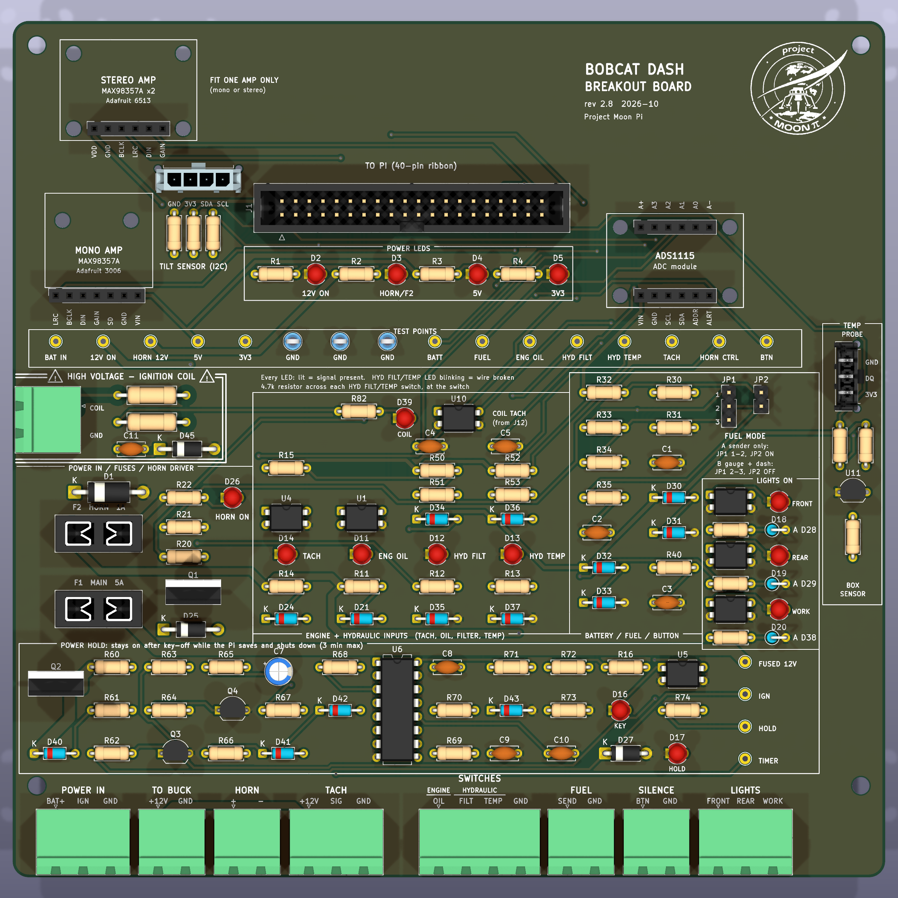

# Bobcat Dash Breakout Board (rev 2.8)

A 162 × 159 mm, 2-layer, all through-hole PCB that sits between the machine's wiring harness and
the Raspberry Pi. Every harness wire lands on a labeled, unpluggable terminal. Every signal has a
status LED or a test point, so you can find a fault with a multimeter and your eyes. Rev 2.0 adds a
**power-hold circuit**: after key-off, the Pi saves the engine hours and shuts down cleanly before the
board turns the power off. Rev 2.1 adds **light sensing**: the dash shows when the front, rear or work
lights are switched on. Rev 2.2 adds a **coil tach input**: the RPM comes straight from the ignition coil, so no
crank sensor is needed. Rev 2.4 gives the coil wire its own plug in a fenced-off **high-voltage corner**, and
outlines every circuit block on the silkscreen. Rev 2.5 adds a **TILT** connector for the roll / pitch sensor; rev 2.6 makes it a latching Molex Micro-Fit. Rev 2.7 adds **temperature**: a sensor for the box's air and a latching connector for external probes. Rev 2.8 takes the current Adafruit ADS1115 board (two header rows) plugged straight in.



## What's on it

| Section | What it does |
|---|---|
| **Harness connectors** (bottom edge) | 8 pluggable 5.08 mm screw-terminal headers, plus the `COIL` plug on the left edge. Each plug pulls off as a block for testing. Every pin is labeled. |
| **Circuit outlines** (rev 2.4) | Every block has a silkscreen outline with its name: POWER LEDS, TEST POINTS, POWER IN / FUSES / HORN DRIVER, ENGINE + HYDRAULIC INPUTS, BATTERY / FUEL / BUTTON, LIGHTS ON, POWER HOLD. |
| **Fuses** | F1 main feed (5 A, for a Pi 4 or a Pi 5), F2 horn (1 A). Mini blade fuses in board-mounted holders. |
| **Protection** | D1 (P6KE20A TVS) clamps voltage spikes. If power is connected backwards, it conducts and blows F1 instead of damaging anything. |
| **Power hold** (bottom band) | Q2 (P-MOSFET) switches the constant battery feed on while the key is on **or** the Pi holds it on. A yellow `KEY` LED shows the key position, a green `HOLD` LED shows the Pi is holding the power. U6 (CD4060 timer) cuts the power 3 minutes after key-off if the Pi hasn't. See [Power hold](#power-hold-rev-20). |
| **Power LEDs** (green) | `12V ON`, `HORN/F2`, `5V`, `3V3`: an unlit LED means the power is off, a blown fuse or a missing supply. |
| **Oil + tach inputs** | Each through a PC817 optocoupler. A **yellow LED lights whenever the input is active** (switch closed / tach pulse). |
| **Coil tach input** (rev 2.2, own corner in rev 2.4) | The `COIL` plug J12 on the **left edge** takes the ignition coil's **negative** terminal, which spikes to ~400 V when it fires. It sits in a **HIGH VOLTAGE** corner with a double outline and warning triangles, like the HV section of an old CRT monitor: everything that sees the raw coil voltage (J12, R80, R81) is inside it, joined by under 15 mm of trace. Two ½ W resistors, a 15 V zener and a 1 µF filter turn the spikes into one clean pulse per spark; only that clamped (≤ 15 V) signal leaves the corner, to optocoupler U10. The yellow `COIL` LED flickers with the engine. It shares the Pi's tach pin with the Hall input (TACH `SIG`): connect **one or the other**. The `COIL` plug's second pin is GND, for a shielded wire's drain. |
| **Filter + temp inputs** | **Monitored** on ADC inputs A2 / A3. With a 4.7 kΩ resistor fitted **at each switch** (see below), the dash can tell OK, switch closed and **broken wire** apart. Their yellow LEDs are driven by the Pi: **on = switch closed, blinking = wire broken**, off = OK. |
| **Light sensing** (right side) | Three PC817 inputs, one per light: front, rear, work. Each takes a sense wire from the **lamp side** of a light switch (a few mA; the lamps' own current never comes through the board). A **yellow `FRONT` / `REAR` / `WORK` LED** lights while that light is on, and the dash shows a matching symbol. |
| **Horn driver** | IRLZ44N MOSFET with a pull-down, so the horn stays off while the Pi boots. **Red `HORN ON` LED** shows when the Pi is switching it on. |
| **Analog** | Battery divider (A0), fuel sender (A1), filter (A2) and temp (A3), all with Schottky clamps and filtering. All four ADC inputs are in use. |
| **Modules** | Sockets for the ADS1115 ADC board and the MAX98357A amplifier board. The outlines show where each module sits. **Amp: fit one of two.** The **mono** board (Adafruit **3006**) goes on **J9** (`LRC BCLK DIN GAIN SD GND VIN`), screwed down through **H9–H10** at its far edge. The **stereo** board (Adafruit **6513**, two MAX98357As) goes on **J16** in the top strip (`VDD GND BCLK LRC DIN GAIN`, no SD), screwed down through **H11–H14** at its corners. Same signals, same software; on the stereo board use the LEFT speaker output (or both). Never fit both: they'd share the same I2S lines. The ADS1115 (Adafruit **1085**, STEMMA QT version) plugs straight in on two 6-pin sockets 12.7 mm (0.5") apart: **J10** for its bottom row `VIN GND SCL SDA ADDR ALRT`, **J15** for its top row `A+ A3 A2 A1 A0 A-`. ADDR is grounded (address 0x48); A+ and A- are the module's own filtered analog supply (outputs) and are left open. Four M2.5 holes (**H5–H8**) line up with the module's corner holes so it can be screwed down on standoffs against vibration (see *Parts to buy*). |
| **Test points** | 16 labeled test points in a strip: power rails, three GND loops for your meter's black lead, and every signal. Four more next to the power hold: `FUSED 12V`, `IGN`, `HOLD`, `TIMER`. |
| **TILT connector** (rev 2.5, latching since 2.6, top-left corner) | J13, a **Molex Micro-Fit 3.0** 4-pin header (43650-0415) with a positive latch, for the machine-angle sensor (LSM6DSOX, Adafruit 4438), on the Pi's I2C bus with the ADS1115. Pins **1 GND, 2 3V3, 3 SDA, 4 SCL**. Cable side: housing 43645-0400 with four 43030-0007 crimp pins (22–24 AWG, ideally 4-core shielded); solder the other end straight into the sensor board (its STEMMA QT socket is friction-only). 100 Ω in SDA and SCL (R83, R84) protect the Pi's pins and soften noise on the cable; 47 Ω in the 3.3 V feed (R85) limits a shorted cable to ~70 mA, so the Pi's 3.3 V (which also feeds the ADS1115) stays up. Keep the cable under ~30–50 cm. |
| **TEMPERATURE** (rev 2.7, right-hand column) | **U11**, a DS18B20 on the board, measures the box's air. **J14 TEMP PROBE**, a latching Molex Micro-Fit 3.0 3-pin (43650-0315), takes external waterproof DS18B20 probes: pins **1 GND, 2 DQ, 3 3V3**; several probes can share it. All on the Pi's 1-Wire bus (GPIO 4, pin 7), with a 4.7 kΩ pull-up (R86). 100 Ω in the probe data line (R87) and 47 Ω in its 3.3 V feed (R88) protect against a damaged probe cable. The board grew 12 mm wider for this column. |
| **Logo** | The **Project Moon Pi** patch, 23 mm across, on the back silkscreen behind the ADC module (it reads correctly when you turn the board over). |
| **To the Pi** | 40-pin box header. A standard 40-pin IDC ribbon cable connects pin 1 to pin 1 on the Pi. |

The sensor GPIO pins are the same as the main README. Rev 2.0 adds three: **KEY = GPIO 6** (pin 31),
**KILL = GPIO 16** (pin 36) and **HOLD = GPIO 26** (pin 37). The dash software handles them (`power.py`);
the Pi needs a one-time setup, described in the main README under *Installing on the Pi*, step 3.
Rev 2.1 adds the light inputs: **FRONT = GPIO 25** (pin 22), **REAR = GPIO 12** (pin 32), **WORK = GPIO 13** (pin 33).
The coil input (rev 2.2) uses the same tach pin as before (GPIO 17), so no new pins.

## Files

| Path | What it is |
|---|---|
| `kicad/` | KiCad 10 project: schematic, PCB layout, design rules. Open `bobcat-dash-breakout.kicad_pro`. |
| `fab/bobcat-dash-breakout-gerbers.zip` | **Upload this to the board maker.** Gerbers + drill files. |
| `fab/board-bom.csv` | Parts that solder onto the board, grouped by value. |
| `docs/schematic.pdf` | Printable schematic (A2): every block drawn with real wires, boxed and named like the board's silkscreen blocks. |
| `docs/mounting-template.pdf` | **Full-size (1:1) drilling template** for the 4 mounting holes, US Letter. Print at *Actual size* / 100 % and check its 100 mm and 6 in rulers before drilling (made by `tools/diagrams/make_template.py`). |
| `docs/board-top.png`, `board-3d.png`, `board-bottom.png`, `board-logo.png` | Renders (`board-logo.png` is a close-up of the logo, top right since rev 2.8). |
| `generator/` | Scripts that generate the KiCad files from one parts-and-connections list (`design.py`). See its README. |

## Verification done

- Schematic electrical rules check (ERC): **0 errors, 0 warnings**.
- PCB design rules check (DRC): **0 violations, 0 unrouted connections**.
- Schematic ↔ PCB parity check: **no differences**. Every pad's net matches the schematic.
- Drill file: 371 plated holes (pads + vias) and 4 mounting holes, which matches the board exactly.
- The power-hold software was tested in the simulator and with simulated GPIO: key-off countdown,
  cancel, short key blips (cranking) ignored, shutdown command run once with the hours saved first,
  a failed shutdown command reported on screen, and no shutdown if the key was never seen on.
- The software path for the monitored inputs was tested with simulated GPIO and ADC readings:
  OK, switch closed, wire cut, wire repaired, and short contact dropouts (which don't cause flicker).

Not done yet: **no board has been built and tested**, including the power-hold circuit, which was
checked by calculation only. Treat the first one as a prototype, and bring
it up with the steps below before connecting the Pi.

## Ordering the bare board

1. Go to a board maker (JLCPCB, PCBWay, OSH Park, …) and upload `fab/bobcat-dash-breakout-gerbers.zip`.
2. Settings: **2 layers, 1.6 mm, 1 oz copper** (2 oz is fine if you want extra current margin),
   HASL lead-free, any solder mask color, quantity 5.
3. The board is larger than 100 × 100 mm, so it won't get the cheapest promotional price. Check the quote.
   Rev 2.0 is 24 mm taller than rev 1.1 (150 × 134 mm): check that it fits your enclosure.

## Parts to buy

Everything in `fab/board-bom.csv`, plus these mating and loose parts that aren't soldered:

| Qty | Part | Notes |
|---|---|---|
| 5 | Pluggable terminal plug, 2-pin, 5.08 mm | Phoenix MSTB 2,5/2-ST-5,08 (1757019) or equivalent: TO BUCK, HORN, FUEL, SILENCE, COIL |
| 3 | Pluggable terminal plug, 3-pin, 5.08 mm | Phoenix MSTB 2,5/3-ST-5,08 (1757022) or equivalent: POWER IN, TACH, LIGHTS |
| 1 | Pluggable terminal plug, 4-pin, 5.08 mm | Phoenix MSTB 2,5/4-ST-5,08 (1757035) or equivalent: SWITCHES |
| 5 / 3 / 1 | Matching PCB headers (2 / 3 / 4-pin) | Phoenix MSTBA 2,5/x-G-5,08 (1757242 / 1757255 / 1757268), right-angle |
| 1 | DIP-16 IC socket (optional) | For U6, so the CD4060 can be swapped |
| 1 + 1 | Inline fuse holder + fuse, 7.5 A and 2 A | 7.5 A at the battery on the BAT+ wire; 2 A at the key switch on the IGN wire |
| 2 | **End-of-line resistor, 4.7 kΩ ½ W 1 % metal film** | Fitted **at** the filter and temp switches, not on the board. See below. |
| 2 | Mini blade fuse holder, PCB mount | Keystone 3568 |
| 1 + 1 | Mini blade (ATM) fuse | 5 A for F1; 1 A for F2 |
| 1 | 40-pin female–female IDC ribbon cable, 15–30 cm | The "GPIO extension" cable sold for Pi breakouts |
| 2 | Jumper shunt, 2.54 mm | For JP1 / JP2 |
| 4 | M3 standoff + screws | Mounting holes are M3 |
| 2 or 4 (+ 2 screws each) | **M2.5 standoff, female–female**, for the amp board | Mono: 2 (H9–H10). Stereo: 4 (H11–H14). Same height rule as the ADC: socket height + the board's header plastic, measured with it seated (about 11 mm with standard parts). |
| 4 + 8 | **M2.5 standoff, 11 mm, female–female** + M2.5 × 5 mm screws | Hold the ADS1115 module down (H5–H8). 11 mm = a standard 8.5 mm female socket + the module's 2.5 mm header plastic: measure yours with the module seated and match it. The standoffs sit right beside the sockets, so use round ones, or 5 mm hex turned flat-side to the socket. Nylon is fine; a drop of thread locker on the metal screws. |

Generic "2EDG" 5.08 mm pluggable terminals usually fit the same footprint. Check the pin
pitch and pin diameter (about 1 mm) against the datasheet before ordering a large batch.

**Check your modules against the silkscreen:** the sockets are wired for the Adafruit pin order:
ADS1115 (two rows) `VIN GND SCL SDA ADDR ALRT` and `A+ A3 A2 A1 A0 A-`, MAX98357A mono (J9) `LRC BCLK DIN GAIN SD GND VIN`,
MAX98357A stereo (J16) `VDD GND BCLK LRC DIN GAIN`.
The ADS1115 sockets fit the current Adafruit 1085 (STEMMA QT, two rows). The older Adafruit board and most
clones have a single 10-pin row and won't plug in directly: use the small **[ADS1115 adapter](adapter/README.md)** board.
Most clones match, but some don't. The pin names are printed next to each socket, so compare them
with the labels on your module before plugging it in.

## Assembly order

Solder the lowest parts first so the board sits flat while you work:

1. Resistors. R80 and R81 (2.2 kΩ **½ W**, the two larger ones at the coil input) take the coil's
   high voltage: use metal film parts rated 350 V or more, and leave them standing ~1 mm off the board.
2. Diodes. **The band goes toward the square pad marked `K`.** Several look alike, so check the print:
   - 1N4148: D21, D24, D41, D42, and D28, D29, D38, which **stand up** (one lead folded down beside
     the body; the band goes to the pad marked `K`).
   - BAT85: D30–D37.
   - Zeners: D40 is BZX79C**15**, D43 is BZX79C**10**, D45 is **1N4744A** (15 V 1 W, the larger DO-41 one at the coil input).
   - 1N4007: D25, D27.
3. Capacitors (C11 is the 1 µF one, near the coil input), then the PC817s (U1, U4, U5, U7, U8, U9, U10) and U6 (or its socket). The dot or notch marks pin 1, at the
   square pad. **C7 is polarized:** its `+` lead goes to the square pad. Use a film capacitor for C8 (timer accuracy).
4. LEDs. **The short leg / flat side goes to the square pad.** Green: D2–D5, D17. Yellow: D11–D14, D16, D18–D20, D39 (COIL). Red: D26.
5. Q3 and Q4 (BC547B): flat face as printed on the outline.
6. Test points, jumper headers, module sockets, the IDC box header (match the notch to the outline).
7. Q1 (IRLZ44N) and Q2 (IRF4905): they look the same, so check the print before soldering. Then the fuse
   holders, D1 (TVS: band toward `K`), and the terminal headers last.

## First power-up (before connecting the Pi)

Use a bench supply set to 12 V with a **current limit around 0.3 A**, or a 12 V battery through a 1 A fuse.

1. **No modules, no ribbon, no harness.** Connect 12 V to `POWER IN` `BAT+` and `GND`, with `IGN` open.
   - Expected: **all LEDs off**, and almost no current (under 0.1 mA): the board is waiting for the key.
     TP `FUSED 12V` reads the supply voltage, TP `12V ON` reads 0 V.
   - Now connect `IGN` to `BAT+` with a wire (this is "key on"). Expected: yellow `KEY` LED, green
     `12V ON` and `HORN/F2` LEDs on. Current draw under 40 mA.
   - Meter: TP `BAT IN` ≈ `FUSED 12V` ≈ `12V ON` ≈ `HORN 12V` ≈ supply voltage. TP `TIMER` ≈ 0 V.
   - **Timer test:** remove the `IGN` wire. The board stays on (the `KEY` LED goes out). After about
     **3 minutes** TP `TIMER` jumps up and the power goes off: `12V ON` goes out. This is the safety net
     if the Pi ever hangs. Reconnect `IGN` to turn it back on.
   - Without the Pi there's no 3.3 V rail, so TP `BATT` reads only about 0.3 V and the `3V3` LED may glow
     faintly. That's normal: the clamp diode is doing its job. Check `BATT` again in step 4.
2. **Test each input with a jumper wire**, with nothing plugged into the harness connectors:
   - `SWITCHES`: touch `OIL` (under `ENGINE`) to `GND`. The yellow `ENG OIL` LED lights.
   - `TACH`: touch `SIG` to `GND`. The yellow `TACH` LED lights.
   - The hydraulic `FILT` and `TEMP` inputs need the Pi (their LEDs are driven by it), so they're tested in step 6.
   Leave `IGN` connected to `BAT+` for the remaining steps, unless a step says otherwise.
3. Power off. Fit the ADS1115 and **one** MAX98357A board (mono on J9 or stereo on J16), set the fuel jumpers (below), and connect the ribbon to the Pi.
4. Power on. The green `5V` and `3V3` LEDs light once the Pi is powered. After the Pi has booted
   (with `gpio=26=op,dh` in its `config.txt`), the green `HOLD` LED is on too. Stop the dash service and run
   `python3 dash.py --calibrate`: the battery reading should match your meter, TP `BATT` should read
   supply ÷ 5.7 (12.0 V → 2.1 V), and the oil switch should show `ON` when you jumper it to GND.
5. Start the dash. At start-up the red `HORN ON` LED blinks with the horn test chirp.
6. **Filter and temp, with the dash running.** Test each one on the `SWITCHES` plug:
   - Nothing connected: its test point (`HYD FILT` or `HYD TEMP`) reads **3.3 V**, its LED **blinks**, and the dash shows **NO SIGNAL**. That's a "broken wire".
   - A 4.7 kΩ resistor from `FILT` (or `TEMP`) to `GND`: TP **~1.65 V**, LED off, dash **OK**.
   - A wire from `FILT` (or `TEMP`) to `GND`: TP **~0 V**, LED on, dash **BYPASS** (or **HOT**) and the horn sounds.
7. **Key-off shutdown**, after the Pi setup in the main README (*Installing on the Pi*, step 3):
   remove the `IGN` wire. The dash counts down `KEY OFF`, shows `SHUTTING DOWN`, and about 20 seconds
   later every LED goes out. Reconnect `IGN` and the Pi starts up again. Also try reconnecting `IGN`
   while it says `SHUTTING DOWN`: the power goes off for a few seconds, then the Pi restarts by itself.
8. **Coil tach input:** with the dash running and **nothing on the TACH `SIG` pin**, touch `COIL` on the
   left-edge `COIL` plug to `BAT+` (12 V) with a wire: the yellow `COIL` LED lights. Tap the wire on and off quickly and
   `--calibrate` shows a few rpm. (A real coil gives one clean pulse per spark; the bench test just proves the path.)
9. **Lights:** with the dash running, touch `FRONT` on the `LIGHTS` plug to `BAT+` (12 V) with a wire.
   The yellow `FRONT` LED lights and the dash shows the green headlamp symbol. Same for `REAR` and `WORK`
   (amber floodlight symbol). Then try it with the key off: the dash shows **LIGHTS STILL ON** and dings
   during the shutdown countdown.

## Fuel jumpers

A fuel sender is a variable resistor to ground. Something has to push a small current through it so its
voltage can be read. The jumpers choose what does that:

| Your setup | JP1 | JP2 | How it reads the fuel |
|---|---|---|---|
| **A: dash only.** The sender wire goes only to the board's `FUEL SEND` pin. | 1–2 | **fitted** | The board feeds the sender through a 220 Ω pull-up and reads the voltage. |
| **B: gauge + dash.** An analog fuel gauge stays wired to the sender as usual (key-switched 12 V → gauge → sender). A second wire runs from the sender terminal (or the gauge's sender terminal) to `FUEL SEND`. | 2–3 | **removed** | The gauge feeds the sender. The board just listens through a 47k/10k divider, drawing about 0.2 mA, so the gauge reads the same as without it. |

**Setup B gives you a backup.** The analog gauge keeps working if the Pi crashes or the monitor dies,
because it doesn't depend on the board at all. Both read the same sender. Run `--calibrate` at empty,
half and full as usual: the dash's table is made for whichever setup you choose. Use a gauge that matches
the sender's ohm range (e.g. 240–33 Ω gauge with a 240–33 Ω sender).

JP1 pin numbers are printed beside it (pin 1 is the square pad, at the top). With setup A, R33 and R34 can be
left off the board. With setup B, R32 and JP2 can be left off.

Never fit JP2 in setup B. The gauge would back-feed the pull-up. It wouldn't damage anything, but the reading would be wrong.

## 3D models

KiCad's own library covers every part except the TILT and TEMP PROBE connectors (Molex Micro-Fit 3.0,
43650-0415 and 43650-0315): KiCad ships no Micro-Fit models. The pictures in `docs/` were rendered with Molex's
own STEP models, but the STEP files themselves aren't included here because Molex's terms don't clearly allow
passing them on. To get them in the 3D viewer and your own renders:

1. On molex.com, search **43650-0415**, open **CAD Models** and download the **STEP** file (free; it may ask
   you to register). It's named `436500415.stp`.
2. Put it in `kicad/3d/436500415.stp` (the folder is in `.gitignore`). For the TEMP PROBE connector, do the same
   for **43650-0315** (`436500315.stp`).

The board already points to both, rotated and offset to sit on their pads. Without a file, KiCad just shows that
connector's pads and outline; nothing else is affected (the 3D model isn't part of the Gerbers).

## Keeping the plugs in

The harness plugs (Phoenix MSTB) hold by friction, which is fine on a bench but not on a machine that shakes
all day. Secure them from outside the board:

- **Best: tie the wires down close to the plugs.** A cable-tie mount (stick-on or screwed) or a strain-relief
  bar in the enclosure, 2–3 cm from the plug row, with each harness bundle tied to it. Then the wires can't
  rock the plugs, and the plugs still come out for testing.
- **Silicone (RTV) or a dab of hot glue** between plug and header also works. Hot glue softens around 70–80 °C,
  which a closed box in summer sun can reach, so RTV is the better of the two. Either makes the plug harder to
  remove later, so use a little.
- The TILT connector latches by itself and needs nothing.

## Harness chart

| Board connector | Pin | Label | Wire goes to | Suggested wire |
|---|---|---|---|---|
| **J2 POWER IN** | 1 | BAT+ | **Constant** battery +12 V, live with the key off. **Add a 7.5 A fuse at the battery** to protect the wire. | 16 AWG red |
| | 2 | IGN | Key switch IGN / RUN terminal (live only with the key on). **2 A fuse at the switch.** Carries only a few mA. | 20 AWG |
| | 3 | GND | Chassis ground, close to the battery ground strap | 16 AWG black |
| **J3 TO BUCK** | 1 | +12V | Buck converter IN+ (fused by F1, switched by the power hold) | 18 AWG red |
| | 2 | GND | Buck converter IN−. The buck output goes to the Pi's USB-C. | 18 AWG black |
| **J7 HORN** | 1 | + | Piezo alarm + (fused by F2) | 18 AWG |
| | 2 | − | Piezo alarm − (switched to ground by Q1) | 18 AWG |
| **J12 COIL** (left edge) | 1 | COIL | **This machine:** ignition coil **negative (−)** terminal (PerTronix + Flame-Thrower 40611). Route it away from the spark plug leads. **Never** put it on any other pin. | 20 AWG, ideally shielded |
| | 2 | GND | The shield's drain wire, if you use shielded wire (ground the shield at this end only). Otherwise empty. | — |
| **J14 TEMP PROBE** (Micro-Fit 3.0, right edge) | 1 | GND | Probe black | 22–24 AWG |
| | 2 | DQ | Probe yellow (or white): data | 22–24 AWG |
| | 3 | 3V3 | Probe red. 3.3 V through 47 Ω | 22–24 AWG |
| **J13 TILT** (Micro-Fit 3.0, top-left) | 1 | GND | Tilt sensor GND | 22–24 AWG |
| | 2 | 3V3 | Tilt sensor VIN. 3.3 V through 47 Ω | 22–24 AWG |
| | 3 | SDA | Tilt sensor SDA | 22–24 AWG |
| | 4 | SCL | Tilt sensor SCL. Under ~30–50 cm; for longer runs see the main README | 22–24 AWG |
| **J5 TACH** | 1 | +12V | *(Hall sensor option only)* Hall sensor **brown** | 20 AWG |
| | 2 | SIG | *(Hall sensor option only)* Hall sensor **black**. Leave empty when the coil is used. Leave the whole TACH plug empty on this machine. | 20 AWG |
| | 3 | GND | *(Hall sensor option only)* Hall sensor **blue** | 20 AWG |
| **J4 SWITCHES** | 1 | OIL (under ENGINE) | **Engine** oil pressure switch terminal | 20 AWG |
| | 2 | FILT (under HYDRAULIC) | Hydraulic filter bypass switch terminal. **4.7 kΩ to ground at the switch.** | 20 AWG |
| | 3 | TEMP (under HYDRAULIC) | Hydraulic oil temp switch terminal. **4.7 kΩ to ground at the switch.** | 20 AWG |
| | 4 | GND | Spare ground: handy for jumper testing | — |
| **J6 FUEL** | 1 | SEND | Fuel sender terminal | 20 AWG |
| | 2 | GND | Sender ground / tank ground | 20 AWG |
| **J8 SILENCE** | 1 | BTN | Silence push button, one side | 20 AWG |
| | 2 | GND | Silence push button, other side | 20 AWG |
| **J11 LIGHTS** | 1 | FRONT | **Lamp side** of the front light switch. **1 A inline fuse** where you tap the wire. | 20 AWG |
| | 2 | REAR | Lamp side of the 3-position switch's REAR position (1 A fuse at the tap) | 20 AWG |
| | 3 | WORK | Lamp side of the 3-position switch's WORK position (1 A fuse at the tap) | 20 AWG |
| **J1 TO PI** | 1–40 | — | Pi GPIO header, pin 1 to pin 1 (ribbon stripe = pin 1 at both ends) | 40-pin ribbon |

This is a new harness: none of the machine's original dash wiring or lamps is used. Each sensor
wire goes only to this board. The switch wires carry only a few mA.

**Don't power the ignition, the electronic distributor, a fuel solenoid or anything else that runs the
engine from this board.** Those stay on the key switch. The board's 12 V outputs stay on for up to
3 minutes after key-off.

## Troubleshooting with the LEDs and test points

Put the black meter lead on a **GND** loop and the red lead on a test point. The values below are with
the key on, the engine off and the dash software running. The Pi's pull-ups on the GPIO lines are only
active while the software runs.

| Test point | Normal reading | If it's wrong |
|---|---|---|
| `BAT IN` | Battery voltage, **even with the key off** | 0 V: check the BAT+ wire and the 7.5 A fuse at the battery |
| `FUSED 12V` | Same as BAT IN | 0 V with BAT IN present: **F1 blown**. If it blows again right away, check for reversed power; D1 may also be shorted. |
| `IGN` | Battery voltage with the key on (yellow `KEY` LED on), 0 V with it off | 0 V with the key on: the IGN wire, its 2 A fuse, or the key switch |
| `12V ON` | Same as FUSED 12V while the key is on or the Pi holds the power, and the `12V ON` LED is on | 0 V with `IGN` present: check Q2, Q3, R60–R64 and D40. Stays on long after key-off: see `HOLD` and `TIMER`. |
| `HOLD` | 3.3 V once the Pi has booted (green `HOLD` LED on) | 0 V: `gpio=26=op,dh` is missing from the Pi's `/boot/firmware/config.txt` |
| `TIMER` | ~0 V. Rises to ~9 V about 3 minutes after key-off if the Pi hasn't shut down, or to ~2.7 V when the Pi cuts the power | The board turns off by itself after 3 minutes, but the Pi never shut down: check the dash is running, the sudoers file and the shutdown hook (main README, *Installing on the Pi*, step 3) |
| `HORN 12V` | The horn's supply after fuse F2: same as 12V ON, and the `HORN/F2` LED is on | 0 V: **F2 blown**. Check the horn wiring for a short. |
| `5V` | 5.0–5.2 V | Pi not powered, or ribbon not connected |
| `3V3` | 3.3 V | Same as 5V |
| `BATT` | Battery ÷ 5.7 (12.6 V → 2.21 V, 14.2 V → 2.49 V) | Check R30/R31 and the D30/D31 orientation |
| `FUEL` | Matches A1 in `--calibrate` (typically 0.3–2.2 V) | 0 V or 3.3 V solid: sender open/shorted, or the jumpers are set wrong |
| `ENG OIL` | 3.3 V idle, ~0.2 V when the yellow LED is lit | LED lit but the reading stays at 3.3 V: optocoupler or Pi problem. LED never lights: harness wire or switch. |
| `HYD FILT`, `HYD TEMP` | **~1.65 V** OK · **~0 V** switch closed (LED on) · **3.3 V** wire broken (LED blinking) | 3.3 V: the wire, a terminal, or the 4.7 kΩ resistor at the switch is open. Meter the harness wire to ground at the dash end with power off: it should read ~4.7 kΩ. Steady ~0 V with the switch open: wire shorted to ground. ~12 V: the wire is shorted to +12 V somewhere. |
| `TACH` | The Pi's tach pin (GPIO 17), after the optocouplers, so it works for **both** inputs (COIL and SIG). Coil input: switches between ~0.2 V and 3.3 V at the spark rate; a meter shows an in-between average while the engine runs, and the **`COIL` LED** flickers. (Hall option: the `TACH` LED blinks each time the magnet passes.) | Engine running, COIL LED dark: check the wire to the coil − terminal. Dash rpm double or half: `pulses_per_rev` (2.0 for the 4-cylinder). Rpm jumpy: wire routed next to the plug leads, or a poor ground. |
| `HORN CTRL` | The Pi's horn command (GPIO 27, at the gate of horn MOSFET Q1): 0 V; 3.3 V while the Pi sounds the horn | `HORN ON` LED lights but no sound: horn or wiring. LED never lights: check `HORN CTRL` while an alarm is active (and `[horn] enabled` in `config.toml`). |
| `BTN` | 3.3 V; 0 V while the button is pressed | Stays at 3.3 V when pressed: button or wiring |

**Lights** have no test points: their yellow `FRONT` / `REAR` / `WORK` LEDs show the input directly. LED off
with the light switched on: check the sense wire's 1 A fuse at the tap, and that the wire is on the **lamp
side** of the switch. LED on but no symbol on the dash: run `python3 dash.py --calibrate` and check
`front=ON` etc. (an optocoupler or ribbon problem).

**Quick visual check, key on, engine off:** green `12V ON`, `HORN/F2`, `5V`, `3V3` and `HOLD` on, yellow `KEY` on, the yellow `ENG OIL` LED on (the engine oil
switch is always closed with the engine stopped), and the other channel LEDs off. A **blinking `HYD FILT` or
`HYD TEMP` LED** means that switch's wiring is broken. **Engine running:**
the `ENG OIL` LED goes out within a few seconds, and the `COIL` LED flickers or glows (one flash per spark).

## Differences from the hand-wired diagram

The board follows `wiring-schematic.jpg` and adds a few things:

- **BAT85 Schottky clamps instead of 3.3 V zeners** on the ADC inputs. A low-voltage zener leaks enough
  current to pull the battery reading low. The main diagram and BOM have been updated to match.
- On-board fuses and the TVS diode.
- A status LED in series with each optocoupler's input, so the LED shows the vehicle-side signal itself.
- Fuel mode jumpers: setup A (dash only) or setup B (an analog gauge as well, as a backup).
- 1 kΩ / 10 kΩ series resistors on the fuel, button, filter and temp inputs, to survive a wiring mistake.
- Monitored filter and temp inputs with end-of-line resistors (rev 1.1).
- An RC filter on the silence button line, against noise picked up on long harness runs.
- The power-hold circuit for key-off shutdown (rev 2.0).
- Light sensing for front, rear and work lights (rev 2.1).
- A high-voltage coil tach input, so the RPM comes from the PerTronix ignition with no crank sensor (rev 2.2).

## Power hold (rev 2.0)

```
BAT+ ─[F1]─┬─ FUSED 12V ─> Q2 IRF4905 source       Q2 drain ──> +12V (buck, tach, horn, LEDs)
           └─ D1 TVS to GND
Q2 gate: R60 47k + D40 15 V zener to the source (keeps Q2 off, limits the gate voltage)
         ─[R61 4.7k]─ Q3 BC547 collector, emitter to GND.   Q3 on = Q2 on = power on.

Q3 base (PWR_ON) ◄─[R62 47k]── IGN (key on)
                 ◄─[R63 10k]── HOLD, GPIO 26 (Pi holds the power on)
                 ──[R64 100k]─ GND
Q4 BC547 shorts PWR_ON to GND (power off, overriding both) when C7 is charged:
   C7 10 µF ◄─[R67 1k + D41]── KILL, GPIO 16 (last step of shutdown)
            ◄─[R68 1k + D42]── U6 CD4060 Q14 (3 minutes after key-off)
   C7 holds Q4 on for a few seconds, so a Pi whose key came back on gets a clean restart.
U6: RC oscillator ~45 Hz (R70 100k, C8 100 nF), held in reset by IGN (R72/R73),
    Q14 goes high after 8192 counts, about 3 minutes. Supply: R71 470 Ω + D43 10 V zener.
KEY: IGN ─[R16 2.2k]─ yellow LED ─ U5 PC817 ─ GND;  U5 output pulls GPIO 6 low = key on.
```

With the key off and everything off, only Q2's leakage and D1's leakage remain: under 0.1 mA,
much less than the battery's own self-discharge.

**Why a timer as well as the Pi's signal:** if the Pi freezes, or the software is never set up, the
board would otherwise keep a Pi running on the battery until it went flat. The timer doesn't depend on
any software.

## End-of-line resistors (filter and temp switches)

Fit one **4.7 kΩ ½ W 1 % metal film resistor at each switch**, from the switch terminal to chassis
ground. Nothing else connects to those two switch terminals. The full step-by-step
instructions, wiring sketch and multimeter checks are in the main
[README](../README.md#end-of-line-resistors-filter-and-temp-switches). The resistor must be at the
**switch end** of the wire, not on this board, or a broken wire would look like OK.

## Revision history

| Rev | Change |
|---|---|
| 1.0 | First design |
| 1.1 | Filter and temp switches moved from optocouplers to monitored ADC inputs A2/A3 (4.7 kΩ pull-up + 4.7 kΩ end-of-line resistor at the switch), so a broken wire shows NO SIGNAL. Their status LEDs are now driven by the Pi (GPIO 23/24). AUX ANALOG connector J11 removed (A2/A3 are now used). U2, U3, D22, D23, R36, R37 removed. |
| 2.0 | **Power hold** for key-off shutdown: Q2 P-MOSFET switch, Q3/Q4, U6 3-minute timer, KEY optocoupler U5 (GPIO 6), HOLD (GPIO 26) and KILL (GPIO 16). POWER IN is now 3-pin: BAT+ (constant), IGN, GND. F2 (horn) moved to the switched +12 V. 4 test points added. Silkscreen marks the switch inputs ENGINE / HYDRAULIC (`ENG OIL`, `HYD FILT`, `HYD TEMP`). F1 is now one value, 5 A. Project Moon Pi logo on the back silkscreen. Board 24 mm taller (150 × 134 mm). Connectors shifted right 5 mm. |
| 2.1 | **Light sensing:** LIGHTS connector J11 (FRONT, REAR, WORK) with optocouplers U7–U9 (GPIO 25 / 12 / 13), yellow status LEDs D18–D20, standing 1N4148s D28/D29/D38. Mounting hole H4 moved up 12.5 mm (to x 145.5, y 117) to make room for J11. |
| 2.2 | **Coil tach input:** TACH connector J5 now 4-pin with `COIL` (ignition coil −). R80/R81 2.2 kΩ ½ W, D45 1N4744A 15 V clamp, C11 1 µF filter, R82, yellow `COIL` LED D39, optocoupler U10 sharing GPIO 17 with the Hall input. Coil wiring routed with 1.2 mm spacing. Mounting hole H3 moved up to match H4 (x 4.5, y 117); connectors J2/J3/J7/J5 shifted 5 mm left. |
| 2.3 | Silkscreen only, no circuit change: `LIGHTS ON` heading over the FRONT / REAR / WORK LEDs, JP1 pins numbered 1-2-3, fuel table says `B gauge + dash`, test point `F1 OUT` renamed `FUSED 12V`. D45 moved down 2 mm so its label and cathode `K` no longer crowd the `FUEL` test point label. |
| 2.4 | Test points `GATE` → `HORN CTRL` and `HORN` → `HORN 12V`. **High-voltage corner:** the coil input gets its own 2-pin plug **J12 COIL** (COIL, GND) on the left edge; TACH J5 goes back to 3 pins (Hall sensor only). J12, R80, R81, D45 and C11 sit together in a corner with a double outline, warning triangles and `HIGH VOLTAGE - IGNITION COIL`; the coil trace is now under 15 mm long instead of crossing the board. **Circuit outlines** with names around every block. Title moved above the test points; notes moved to the middle. Logo moved behind the ADC module (23 mm). D1 down 1.5 mm. **R15 (tach pull-up) 4.7 kΩ → 10 kΩ**: the optocouplers need half the current to pull GPIO 17 low, so a worn or hot PC817 still reads the coil reliably on a 12 V system. |
| 2.5 | **TILT header** J13 (GND, 3V3, SDA, SCL) for the roll / pitch sensor, top-left corner, with R83 / R84 (100 Ω, SDA / SCL) and R85 (47 Ω, sensor 3.3 V). Schematic: new TILT SENSOR HEADER block. |
| 2.8 | **Board 25 mm taller (162 × 159 mm)**: a new strip along the top holds the **stereo amp** site (J16, Adafruit 6513, with corner holes H11–H14), the board title and the **Project Moon Pi logo, now on top**. The mono amp (J9) keeps its place and gets standoff holes H9–H10. Top mounting holes H1/H2 moved to the new top corners: hole spacing 153 × 137.5 mm (new drilling template). **ADS1115 plugs straight in:** the current Adafruit 1085 (STEMMA QT) has two 6-pin rows 12.7 mm apart, so the single 10-pin socket became **J10** (VIN GND SCL SDA ADDR ALRT) and **J15** (A+ A3 A2 A1 A0 A-). Same signals and address; no software change. Four M2.5 holes (H5–H8) under the module's corner holes for standoffs. |
| 2.7 | **Temperature:** DS18B20 U11 on the board (box air), latching 3-pin Micro-Fit **J14 TEMP PROBE** for external DS18B20 probes, R86 4.7 kΩ pull-up, R87 100 Ω / R88 47 Ω probe protection, on GPIO 4 (Pi pin 7). New TEMP column on the right edge: the board is **12 mm wider (162 × 134 mm)**; mounting holes H2 / H4 moved 12 mm right. |
| 2.6 | J13 TILT becomes a **latching Molex Micro-Fit 3.0** (43650-0415) instead of a bare pin header, so vibration can't shake it loose; resistors moved down to fit. Harness connectors stay Phoenix MSTB (they take the 14–16 AWG harness wire); secure them externally (see *Keeping the plugs in*). |
