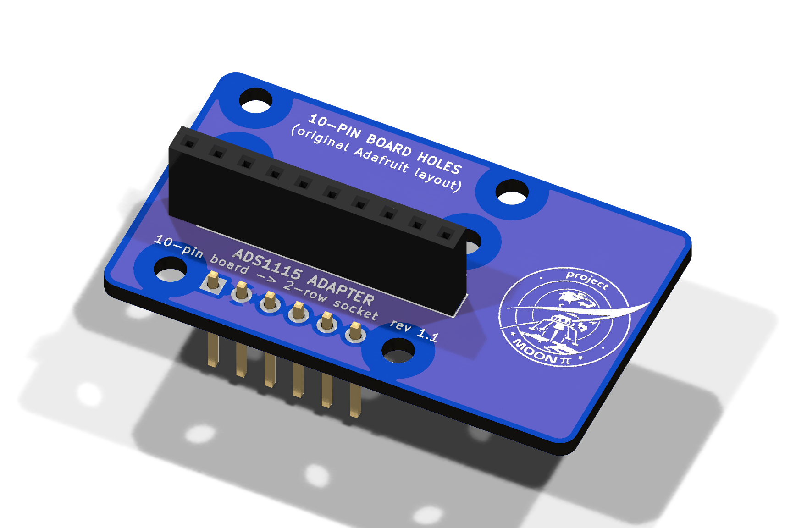
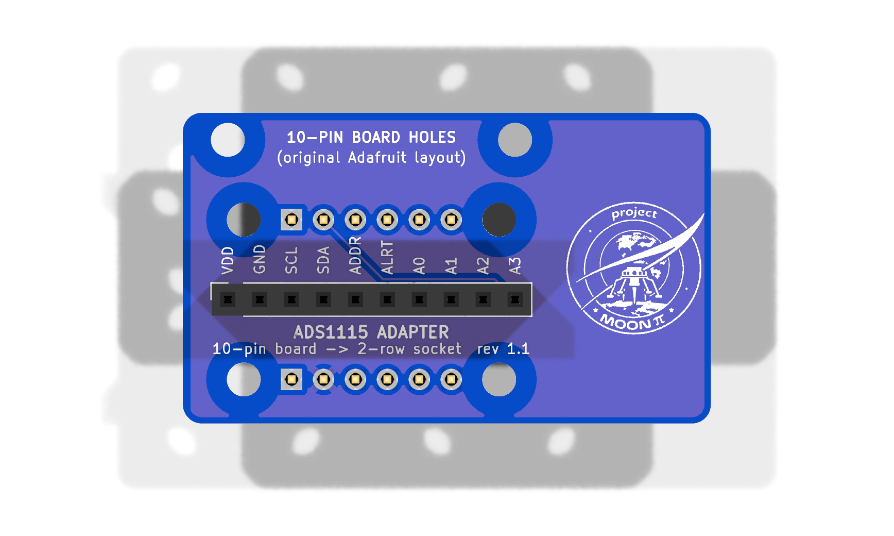
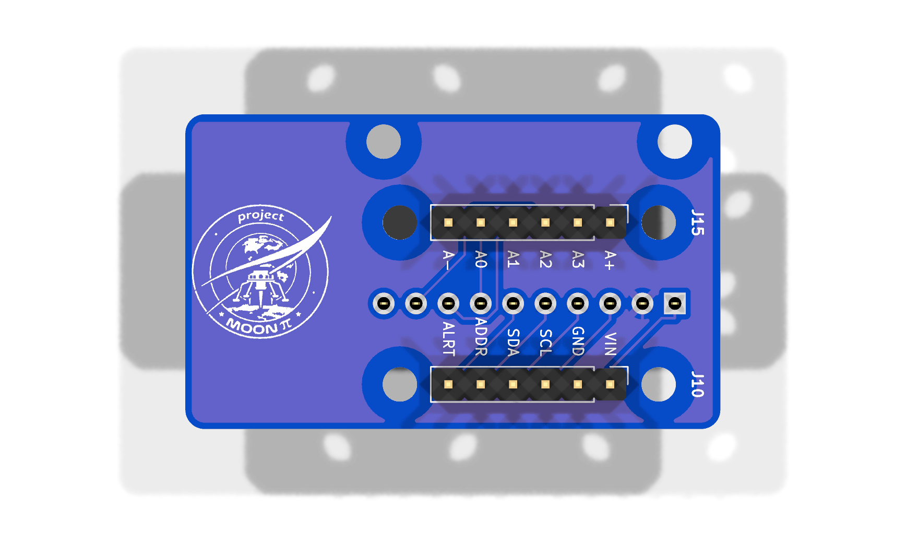

# ADS1115 Adapter (rev 1.1)

The breakout board (rev 2.8) takes the **current Adafruit ADS1115 (product 1085, STEMMA QT version)** directly:
two 6-pin rows 12.7 mm (0.5") apart, plugged into **J15** and **J10** and screwed down on H5–H8.

If that board isn't available, this adapter takes the other common ADS1115 layout: **one 10-pin row** in the order
`VDD GND SCL SDA ADDR ALRT A0 A1 A2 A3`. That's the older Adafruit 1085 and nearly every clone. Check the labels
on your module match that order before plugging it in.

- **Underneath:** male pins in the same two-row pattern as the Adafruit board (J1 into the breakout board's J15,
  J2 into its J10), and the same four M2.5 holes, so it sits on the same 11 mm standoffs.
- **On top:** a 10-pin female socket (J3) for the module, and two M2.5 holes (H5, H6) for the module's own
  mounting holes, so it's screwed down too, not just held by its pins. They match the original Adafruit 10-pin
  board (holes on its far edge, 12.7 mm from its pins, in line with pins 1 and 10). Clones vary: check yours.
- **Wiring is straight through:** same signals, same address (0x48: ADDR is grounded on the breakout board),
  **no software change**. A+ / A- of the two-row pattern aren't used.

| | |
|---|---|
| Size | 42 × 24.7 mm, 2 layers, 1.6 mm. The right-hand 12 mm carries the Project Moon Pi logo, top and back (beside the module, so it stays visible); on the breakout board it sits over the empty space between the ADC module and the TEMP column |
| Schematic | [docs/schematic.pdf](docs/schematic.pdf) |
| Gerbers | [fab/ads1115-adapter-gerbers.zip](fab/ads1115-adapter-gerbers.zip): order it with the main board (most makers sell 5 minimum for a few dollars): **blue solder mask, white silkscreen**, HASL lead-free, 1.6 mm, to match |
| KiCad files | [kicad/](kicad/) |

 

## Parts

| Qty | Part | Notes |
|---|---|---|
| 1 | Bare adapter PCB | `fab/ads1115-adapter-gerbers.zip` |
| 2 | Male pin header, 1×6, 2.54 mm, straight | J1, J2: soldered from **underneath** (plastic under the board, short pins through the top) |
| 1 | Female socket, 1×10, 2.54 mm, straight | J3, on top |
| 4 + 8 | M2.5 standoff, 11 mm, female–female + M2.5 × 5 mm screws | The same as for the Adafruit board: H1–H4 line up with the breakout board's H5–H8 |
| 2 + 4 | M2.5 standoff, female–female + M2.5 × 5 mm screws, for the module | H5, H6. Height = the socket + the module's header plastic, measured with it seated (about 11 mm) |

## Fitting it

1. Solder J1 and J2 with the adapter **plugged into the breakout board's sockets**, so the pins line up.
   The square pads are pin 1 on both boards.
2. Fit the module's two standoffs to H5 / H6 now: their screws go in from underneath, which you can't reach
   once the adapter is on the board.
3. Screw the adapter down on its four standoffs (H1–H4 onto the breakout board's H5–H8). Do this **before**
   fitting the module: the module covers those screws.
4. Plug the 10-pin module into J3 (pin 1, VDD, at the square pad, labels matching the silkscreen) and screw it
   to its standoffs. If a clone's holes don't line up, a dab of silicone or a cable tie keeps it from rattling.

## Rebuilding

`generator/build.sh` regenerates everything (schematic → board → routing with the breakout board's
`route.py` → ERC / DRC / parity), using KiCad 10 and Freerouting like the main board.
