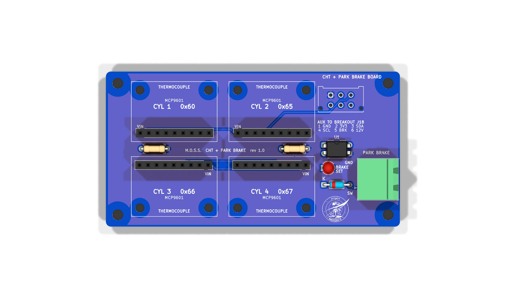

# CHT + Parking Brake Board (rev 1.0)

A small board (87 × 46 mm) for the electronics box, on a short latching cable to the breakout board's
**AUX** plug (J18, breakout board rev 3.0). It carries:

- **Cylinder head temperatures (CHT):** up to four Adafruit **MCP9601** thermocouple amplifier modules
  (product 5165), one per cylinder, plugged into sockets. Fit only the ones you need.
- **Parking brake input:** the switch on the handle comes in on a 2-pin Phoenix plug, through an optocoupler,
  to the Pi (GPIO 9). Green **BRAKE SET** LED while the brake is set.

## Thermocouples

- Sensor: The Sensor Connection **CHT-FS-072-06-18-K-MP** (or -120- / custom 144 in lead): Type K, ungrounded,
  18 mm ring for the Wisconsin VH4D's plugs, rated to 1000 °C.
- Each module has its own 2-screw terminal: the Type K wire (or Type K extension wire) goes **straight into it**.
  That terminal is the cold junction, right beside the chip that measures it, so there's nothing in between.
  US colours: **yellow +, red −** (the module marks + and −).
- Only Type K extension wire and Type K (yellow) mini connectors between the sensor and the module. For the
  box wall, panel-mount mini K jacks, then a short piece of K wire inside to the module.

## Addresses

The socket sets each module's I2C address through its ADDR pin, the same way the module's own address jumpers
do, so **leave the modules' 22k / 43k jumpers open** and any module works in any socket:

| Socket | Cylinder | ADDR | Address | `config.toml` |
|---|---|---|---|---|
| M1 | 1 | to GND | 0x60 | `{ name = "1", address = 0x60 }` |
| M2 | 2 | 22k to GND (R1) | 0x65 | `{ name = "2", address = 0x65 }` |
| M3 | 3 | 43k to GND (R2) | 0x66 | `{ name = "3", address = 0x66 }` |
| M4 | 4 | open | 0x67 | `{ name = "4", address = 0x67 }` |

List the fitted ones in `[cht] cylinders`. With one sensor, put its module in the socket for that cylinder.

## Parking brake

`J2 PARK BRAKE`: **SW** and **GND**. A sealed switch on the handle that **closes when the brake is set**
(e.g. a sealed roller-lever microswitch, IP67, with a factory pigtail; a weather-sealed Deutsch DT 2-pin at the
handle). Then `[park_brake] enabled = true`. The 12 V comes from the breakout board through 2.2k (R97), so the
cable can't draw more than ~5 mA even shorted.

## Assembly

- Modules: solder the 9-pin header that comes with each module **pins down**, plug it into the socket, and screw
  its two holes down on **11 mm M2.5 standoffs** (the holes are on the terminal edge).
- Board: four **M3** corner holes. The AUX cable: two Molex Micro-Fit 3.0 2×3 housings (43025-0600) and
  six crimp pins (43030-0007), **pin 1 to pin 1** straight through.
- The modules' SDA / SCL each have a 10k pull-up; with four of them on the bus the total is still fine for the
  Pi's I2C at 100 kHz.

## Files

- `kicad/`: KiCad 10 project (schematic + board), made by `generator/` (`bash generator/build.sh`, reusing the
  breakout board's `route.py`).
- `fab/cht-board-gerbers.zip` for PCBWay (blue mask, like the breakout board), `fab/cht-board-bom.csv`.
- `docs/`: schematic PDF and renders.

Module pinout from Adafruit's design files (Adafruit-MCP9601-PCB, header JP3): VIN GND SCL SDA ALERT1-4 ADDR.
