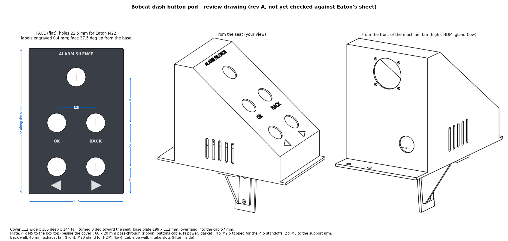

# Button pod (rev A, draft)

Holds the dash's 5 buttons on top of the electrical box, at the **front end** of the box top. The face is
tilted **37.5°** up from the base and faces the **back of the machine** (toward the seat). It overhangs about 67 mm
into the cab, where a support arm under it screws to the box's seat-side panel.

**Draft:** the button holes and the depth behind the panel still have to be checked against Eaton's M22 sheet
before ordering. Change the numbers at the top of `make_pod.py` and run it again; it rewrites every file here.

| Part | File | What |
|---|---|---|
| Cover | `pod-cover.step` (`pod-cover-own-frame.step` = sitting flat) | 2 mm aluminium (5052) or stainless, powder-coated. 5 holes 22.5 mm, labels engraved 0.4 mm, inward bottom flange with 4 × M4 holes |
| Base plate | `pod-base.step` | 3 mm. 4 × M5 to the box top (beside the cover), 4 × M4 tapped (or PEM nuts) for the cover, 16 mm cable grommet hole, 2 × M5 for the arm |
| Support arm | `pod-arm.step` | 3 mm L-bracket, **one bend, no welding**: top leg under the overhang (2 × M5 up through the base plate), leg down the seat-side panel (2 × M5 into the panel) |
| Triangle (gusset) | `pod-gusset.step` | Separate bent piece with a tab along its top edge and one along its upright edge. The arm's own 4 bolts clamp both tabs: **bolt-on, no welding** |
| All together | `pod-assembly.step` | for checking the fit; STL files of each part too |

**Buttons:** Eaton M22: 4 × black flat-style head (◀ ▶ OK BACK) and 1 × M22-DP-R red mushroom (ALARM SILENCE), each
with an M22-A fixing adapter and an M22-K10 (normally open) contact block. Wire each button between its BUTTONS-plug
pin and GND; one 6-core cable goes down through the grommet to the breakout board.

**3D printing** (ASA, or nylon PA12, for sun and heat): the cover, the arm and the triangle can be printed. Set `AT` (arm and triangle thickness) to about 5–6 mm and use metal washers under the bolt heads; for a printed cover make the walls ~3–4 mm (`T`; the Eaton M22 clamps panels 1–6 mm). Keep the **base plate aluminium**: it carries the Pi's heat into the steel box. Pick a light colour: a dark pod in the sun runs much hotter.

**Rebuild:** `pip install cadquery`, then `python3 make_pod.py`.
